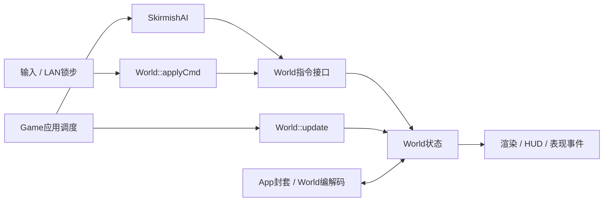

# OpenRA2 当前架构

本页描述2026-11-19收敛后的职责与合同。历史逐批记录原样保存在[旧架构记录](history/architecture-through-2026-11-18.md)，不作为当前版本依据。变更范围及验收见[收敛审查](convergence-review.md)，开发方式见[开发流程](development.md)。

## 运行依赖与执行顺序

项目使用C++23、raylib 5.5、Lua 5.4.6和CMake。`Game`负责应用流程、输入、任务/AI调度、存档封套和界面；`World`拥有确定性模拟状态及实体生命期。`SkirmishAI`通过已有World指令入口控制单位。原始事件、队伍脚本和生产执行作为World的子系统运行。

模拟按逻辑tick更新，随机数、指令顺序和实体身份参与确定性约束。显示帧、音频与表现事件不驱动模拟。顺序校验、二进制保存和渲染派生数据各有用途；不要通过复用一个序列化器改变历史校验字节。

生成地图的软迷雾遮罩每六个逻辑tick刷新一次。`bakeFogMask`按固定宽度的菱形扫描行填充遮罩，重叠时取最深一档，未覆盖像素全不透明。地形投影、迷雾不透明度和双线性采样决定实际显示，原生地图继续使用它的地形遮罩缓存。

World仍是中央状态对象，许多字段对内部子系统公开。此次分拆建立了职责和写入入口，没有将它改写成ECS，也没有完成所有字段的访问封装。

普通遭遇战和联机入口默认选择RA2来源规则与美国，融合和YR可从规则选择器进入。RA2规则来源为`ra2-local-base`。读档与重开使用保存的规则和国家。RA2新规则通常写World64，离位或等待寻路时的指定回厂使用World65，已经驶往或等候指定精炼厂的武装矿车写World66。新的武装矿车入泊或转向离位状态写World67，运行中的二次宽弯写World68。超时空矿车待传送至泊位或尚未转东就收到离位命令时使用World69，正沿地面路径为同厂出泊矿车让位时写World70，保留第一个卸矿周期的启动帧时写World71，武装矿车等待按定速离位时写World72，等待或正在加速出泊时写World73。活动三次宽弯使用World74。联机协议为LAN95，App封套为11或12。覆盖融合四阵营或早期World格式的回归夹具显式选择融合规则，正常菜单输入回归使用RA2默认开局。

生成地图的抢地盘出生区由`world_initialization.cpp`在创建初始部队前选择。各家使用实际规则的建造厂脚印，保留可通行的护卫位置与互不重叠的出生区；不改地形、不额外增加单位。Game只应用模式的全图揭示和补给箱选项，不再在World初始化后挪动基地车坐标。普通Battle与作者地图的出生流程不变。

菜单和结算遮罩先接收输入，本帧隐藏HUD不再处理鼠标按键、键盘和侧栏滚轮。帧开始时已经存在的遮罩会占有整帧事件，点击“继续”后也不会把同一个点击传给HUD。该路由状态只属于Game表现层，不进入World、存档或网络命令。

鼠标默认使用经典左键发令、右键取消，可在设置中选择现代右键发令，并写入本机`settings.ini`的`classic_orders`。经典模式的潜在指令在左键松开时判断：大拖动执行框选，小拖动执行已有智能命令；松手落在HUD则取消该次指令并保留选择。友军普通点击仍可切换选择，进入/维修等动作沿用原准入。此路由复用相同World命令，不新增模拟、App保存或LAN字段。

联机握手安装World后，与普通开局一样准备当前地表、预载本地素材并按新地图钳制相机。首次联机和从其他地图进入联机都重建表现数据；准备地表与绘制开局不改变模拟校验值。

灰熊、犀牛、天启、光棱、幻影、磁能坦克、坦克杀手和盟苏矿车使用32个按需缓存的VXL朝向。车体与独立炮塔共享覆盖所有朝向的物理模型原点；点选使用当前显示姿态的包围盒。Scene45的来源地面车辆使用`native_ground.h`保存两套16位方向计时，`world_native_ground.cpp`由原始ROT、目标角度和逻辑时间推进；90度/ROT5为12原版帧、24项目tick。跨零点和半途改向按实际本地原程序FacingClass的整数除法顺序处理。移动的大转角先原地转向，小转角允许原有轨迹继续；开火沿用既有射界，但判断实际计时角度。Drive的同层同高度直角宽弯已有位置和朝向采样。其他弯道与完整原版射界待进一步校准。渲染只读取角度和上一tick的表现快照；表现快照不保存、不入checksum。旧来源规则继续原有八方向逻辑和显示插值；SHP步兵、特殊来源模型、IFV、飞机与部署动画保留各自绘制路径。

地面车辆已启用计时转向时，首发和连发都使用开火时的16位车头或炮塔角度。续发已就绪而目标超出射界时，下一发继续等候正常瞄准。

灰熊、犀牛和幻影的炮口火光使用发射事件记录的炮塔角度与地面高度。独立炮管的末端用和炮塔贴图相同的体素变换投影，与炮塔姿态一同缓存。表现层按事件坐标绘制火光，炮弹和命中由 World 独立结算。

Scene44/Production7引入`HarvesterLoadRate`（支持1..1000个原版帧/阶段）；Scene45/Production8继续该合同。原程序默认2帧，采矿核心经过9阶段取一份矿，对应30 Hz项目默认36 tick。YR仍为Scene43/Production6；旧Scene37/43及缺省旧Scene42保留20 tick。采集方法与计时的隔离调用见`tests/fixtures/ra2-harvest-reference.json`。

Scene45的矿车通过原有合法回厂指令接入`world_native_ground.cpp`：等候可用矿厂，接近+(4,1)，车头朝东(0x4000)后倒车进入+(3,1)泊位，卸完正向驶出。每厂同时只有一个世代绑定的泊位占用；出口保留给当前矿车，耗尽矿区后停在出口的空车通过既有交通让路流程移动。Stop/Move先离开泊位再继续，销毁、易主或外部瞬移清理预约并保留剩余货物。超时空矿车的原有回厂瞬移落在进出点后继续正常停靠，不据此声称完整ChronoLocomotion时序。默认卸矿门槛为15原版帧、30项目tick，每次处理首个非空资源类型的全部数量（矿石先、宝石后），空库存再经过一个周期后离开；精炼器按每类整批数量计算增益。原程序函数调用、坐标/朝向指令和528个角度样本见`tests/fixtures/ra2-ground-reference.json`，不是完整原版对局。

盟军超时空矿车与苏军武装矿车的行驶和卸矿姿态共用模型原点、贴图画布与阴影落点。姿态切换时以车体的世界坐标定位，点选读取当前姿态的实际边界。

计时卸矿在每批入账时核对货款接收方的电力。有效供电达到需求时计入矿石精炼器增益，供电不足时按基础矿价入账。需求为零按足电处理。每批正额入账的逻辑tick发出到账提示，联机客户端按入账玩家编号播放。提示是一次性表现事件，读档后从已保存的批次进度继续卸载。

`world_native_ground_save.cpp`在World63的Crew60后追加`GND1`有界块，保存已初始化单位的两套转向起点、目标、起始帧、时长，以及矿车阶段和矿厂世代引用；这些字段参与checksum。World61/62仍仅用于冻结全局AI，不将63误判为AIGL扩展。旧普通规则继续写World60，旧Scene44/Production7保留旧停靠、卸载及转向；App11/12仍通过暂存World后整体安装，错误扩展或头部组合不能替换活跃游戏。地图Scene42以`RulesBaseVersion=45`选择新RA2行为；地图封套自身不增加App字段。

地面矿车在进站格内重发回厂时，若仍在同一移动层上且离格心超过进站容差，返厂路线保留最后一段格内移动。Scene46武装矿车在进站点预约泊位，向西驶入。进入泊位格时请求朝东，在泊心且实际朝东后开始卸矿。触发格与本地RA2 1.08隔离无线电对照一致。对照使用给定格坐标，原版连续行驶轨迹与握手间隔仍待实机测量。

地面矿车规划返厂和执行停靠时共用矿厂可用性检查。矿厂被冻结时，已入泊的矿车先驶离原泊位，再携带剩余货物改道至可达的己方矿厂。

地面矿车和超时空矿车共用泊位地形检查。进站格和泊位须可通行，两格高差须在地面爬升上限内。矿车到达同一通行层的进站格中心后办理停靠。旧档中已入位的矿车遇到停靠条件不满足时，携货驶出后重新选厂。

矿车持有预约时，再次明确指定同一座仍可用的精炼厂会确认当前回厂任务。待执行的传送和实际停靠均从已有进度继续。超时空矿车等候泊位时，确认同一座精炼厂会记住玩家的选择，并按原计时再次尝试预约。在进站路上重新发出回厂指令可以重新规划路线，在泊位中指定另一座精炼厂时先驶离当前泊位。

进站格有车辆时，地面矿车先走常规让路和重寻路流程。路线耗尽后进站格仍被占用时，矿车优先选择可达且进站格空闲的同方矿厂。缺少可用替代路线时，矿车保留原来的回厂任务，继续等候进站。

武装矿车会记住玩家指定的己方精炼厂，并在寻路额度恢复后尝试规划路线。若当前泊位由另一辆矿车预约，它在原处等候并给泊位出口留空，车位腾出后继续进站。该选择在矿车驶出旧泊位后也有效，获得新泊位或失去目标时结束。自动回厂仍按可达性和空闲泊位选择精炼厂。

启用计时停靠的矿车卸完驶离时，从实际离位位置核对旧矿区的采矿路线。旧矿区被隔断时，从矿车所在地查找可达矿点，确定路线后开始下一趟。身边有可采矿点时直接进入采矿流程，找不到矿点时继续按空闲扫描周期重试。

同批固定自然对局暴露了固定翼飞机攻击移动的到达判定不一致：飞行已按0.4格容差到达，保留意图仍要求0.05格，导致侦察航段反复恢复。Scene45沿用飞行控制器已经作出的到达结果完成同一目的地的指令，不改变飞行轨迹、弹药或AI目标信息；历史场景保留原合同。泊位出口预约只约束其所在移动层，不阻挡上层桥面。

同一固定雪地图还暴露了多架慢速飞机重复执行相邻搜图航段。Scene45的普通AI将己方现有侦察目的地传给既有迷雾选区函数，分散新派航段；不保存新的AI状态，不读取隐藏敌人的位置，不改变原始AI或已接受的交战指令。历史规则保留原有选区。

Scene46在有效的履带车辆路径上选取同层、同高度的连续拐角。`world_drive_turn.cpp`用起终点都位于拐角格内的二次曲线连接直线段。弯行按实际弧长扣除速度累积量，换算率在相邻直段的直行与斜行速率之间过渡。车头进入弯道前按ROT对正，行进中的紧弯车头随弧线切线更新。World在每个tick开始时采样车体和炮塔角度，供渲染插值使用。碰撞、地形和交通预约由`moveAlongPath`准入与提交。履带车沿直线段行驶前先对正，剩余角度进入一逻辑tick的ROT转向额度后才平移。等待转向时清空速度累积量。新移动指令从实际坐标重新规划。若新路线仍走原出口，且出口与弯道同层同高，坦克会完成当前弧线，再接上新路线。改走其他出口会结束当前弯行。

两个正交步在同层同高并且出口可通行时，履带坦克可沿三次曲线从前一格格心驶到后一格格心。车头随弯道进度平滑入弯和出弯，移动量按曲线弧长扣除。原版1.08的两步轨道样本用于校准5度、45度、85度时的位置及整段距离。曲线参数到一半时，坦克在拐角格交接路径节点。两个阶段都在推进前检查单位占位和出泊矿车保留的进出格。已有障碍挡住出口时可走格内紧弯，途中遇到阻挡则按普通交通规则等候或重寻。

弯道按路径和地形规划。出口格被临时占用时，坦克仍可在拐角格内完成曲线并对正车头。进入出口格前会执行普通的碰撞、让路和交通准入，必要时先在弯道末端等待。

追击途中的定期重算也使用同出口续弯规则。新路线选中原来的同层、同高度出口时，拐角格留在路线首段。已经驶入拐角格的坦克可以继续驶到起弧点。正在弯行的坦克保留当前朝向和行驶进度，完成弧线后接上新路线。

玩家下达停止时，履带车辆结束当前移动和计时转向，分别保留命令执行时的车体和炮塔角度。两个角度沿用现有存档字段，后续指令从实际姿态启动。AI内部暂缓移动沿用其调度策略。

`World::applyCmd`接收的即时编队移动依据队伍中心到落点的八向航向排出方阵。`orderMove`先沿行进方向划分前后排，再按每排的侧向站位分配落点，同位时用实体编号决定顺序。地形、目的格预约和分层寻路仍会调整实际可到达的位置。AI、作者指令和追加路径点采用各自原有分配。Scene46履带坦克遇到同层同向并有下一步的己方履带车，可边等候边转向，最多等候90逻辑tick后回到原有堵塞处理。存档继续记录实际路径、转向和已等待时间。

单辆履带坦克在窄路弯中收到沿来路返回的指令时，可释放旧的通行方向。玩家在直线段下达沿来路返回的即时移动命令时，也可释放该方向。直线判断使用车体实际坐标到旧路线下一点的方向，坦克已经跨入下一格时仍能识别掉头。释放要求车道内只有这辆坦克、且尚未进入疏散阶段。下一次通行准入根据新路线选取出口，坦克对正车头后开始平移。

窄路内的退让路线被尽头格卡住时，恢复流程检查该步实际通行层的占位单位。找到双方下一步互相硬挡的友军后，可以改用另一出口并继续前往原目的地。步兵满格时会继续检查队首之后的占位者。车辆、步兵和桥面各自按实际通行层校验占位，退让仍使用普通路径和每tick寻路预算。

重发即时编队移动时，使用当前已分配的地面落点核对请求是否匹配同一组合法落点。已经停稳的单位可留在原位，正在行驶的单位须处于相同移动模式、目标层且路线未受阻。修改攻击移动模式、调整到其他落点或覆盖排队命令时，重新走普通移动准入。判定使用存档已有的目标、路径和单位状态。

泊位内矿车的编队落点以同层外侧格的连通区域筛选。移动路径从矿车的实际位置生成。矿车先由停靠流程驶到外侧格并释放预约，再沿获准的路径前往编队落点。

单位在目标格内重寻路成功时，`repathUnit`保留抵达格中心的最后一段移动。即使寻路结果没有格间节点，单位也会走完格内位移，再进入到达状态。

经典左键已有选中单位时，光标和命令分派通过`pickCommandUnit`判断单位目标。单位显示范围和同层实际占用格参与下令判定，主动选取和Shift加选可使用邻近命中。点击编队旁的空地仍走普通`Move`入口，联机沿用实体编号和世代绑定。

Scene46的超时空矿车通过`world_harvester_warp.cpp`预约单一泊位。预约绑定矿厂世代与实际落点，可跨越断开的地面路径。泊位 +(3,1) 可用并获准后，矿车在下一移动更新内直接落到泊位格心，保留起跳朝向，随后转东并开始卸矿。外侧格 +(4,1) 有车时仍可落在空闲泊位，卸完后按实际占位等待驶出。实际位移成对发出离场与到达效果，已在同层同坐标的矿车直接对正。落点、车头与已接纳后的节拍来自本地RA2 1.08的无线电、通行与传送函数对照。矿厂销毁、易主或新指令会释放预约，受阻时每12逻辑tick重试。直接落地后收到停止、移动或换厂指令时，矿车转东并先驶出原泊位。

Scene46的武装矿车与超时空矿车新进入泊内卸矿后，首笔整批入账在默认第32逻辑tick。随后每类资源和最后的空载检查各间隔30 tick。原版卸矿任务先检查计时，再推进同帧的阶段，实际首笔在第16原版帧。武装矿车正常卸空且准备返回仍有矿的原矿点时，在站内保留泊位，于空载检查后的第34个逻辑tick启动出泊。这个间隔采用本地原版隔离案例中空载检查到回采目标下达的17帧。原版回采调度含随机延迟，本项目使用该次测得的固定间隔。

武装矿车出泊时用普通Drive计算油门、速度和直行位移。减速距离以记忆矿点为终点。站内只向东驶向外侧格心，每次位移前检查实际占格和碰撞，受阻时丢弃当次位移余量。到达外侧格心后释放预约并按当前地图选路。若接回同一个矿点且同层直行，当步余量和速度可继续用于普通移动。原矿点缺失或采空时会重新找矿。停止、改点或矿厂失效会取消出泊驱动，按撤泊流程离开。原版平地校准使用真实回采寻路和Drive，夹具提供记忆矿点。

直接传送模式下，正在外侧格等候同厂的超时空矿车可以响应出泊矿车的让行请求。它沿普通地面路径驶向可用的空地，让位期间保留目标矿厂世代、货物和重试余量，路径结束后恢复回厂重试。前车到达外侧格并释放泊位后，后车方可传入。无可通行的让位路径时继续等候。

武装矿车还在进站格时可以直接改选精炼厂。占用泊位后，改点同方另一座精炼厂会中止本次卸货并先驶出。尚未朝东的武装矿车先在原位转东再驶离。World保留最后指定的精炼厂世代引用，驶出后按普通地面回厂或超时空回厂流程接近新泊位。已入账的矿石保留，剩余货物由实际停靠的矿厂卸载。停止、指定目标销毁和易主会取消该目的地。

World64在`GND1`后追加`TRV1`，记录当前弧线进度或正在回厂的传送阶段及剩余tick。矿厂身份沿用`GND1`内保存的世代引用。旧存档的传送准备与落地稳定状态继续使用原来外侧 +(4,1) 的落点和保存的计时。嵌入Scene45或以45为基础规则的地图通常写World63，其他旧普通规则写World60。World65在World63或World64数据后追加`DDR1`，按矿车记录离位或等待寻路时的目标精炼厂世代引用。World66沿用`DDR1`的记录布局，并允许武装矿车在进站阶段保留选择。World67用于新的武装矿车入泊阶段或尚未朝东的离位状态，沿用`GND1`和`TRV1`布局，随后写出可为空的`DDR1`。World68在存在活动二次宽弯时使用`TRV1`的第4类记录，保留同一份尾部布局及矿车状态。World69允许`TRV1`第5类的泊位传送记录及超时空矿车在泊位中心尚未转东的离位状态，可以同时保存宽弯。World70要求至少一辆等待直接传送的矿车有活动让位路径，沿用第5类记录和已有地面路径字段。World71要求至少一辆正在卸矿的矿车仍处于最初两个逻辑tick，沿用有符号卸矿计时字段，也可保存宽弯和让位路径。World72要求至少一辆空载武装矿车在泊心朝东等待离位，沿用同一有符号计时字段和尾部布局，可同时保存World71允许的活动状态。历史存档中已经开始的紧弯、进站对正和倒车入泊均按记录继续。读档核对路径、进度、泊位占用、命令阶段和实体身份。运行校验值覆盖轨迹类型与待执行命令。

World73要求至少一辆空载武装矿车在等待或执行Drive出泊。`GND1`记录新的离位阶段，原有移动记录保存油门、半帧和位移余量。World73也容纳World72及更早支持的同时活动状态。World72档按保存的等待计时归零后定速离位，正在定速离位的World64档继续当时的轨迹。

World74要求至少一段活动三次宽弯。TRV1第6类沿用已有弯道字段，类别参与校验值。World74可同时保存加速出泊、超时空回厂和先前支持的活动状态。第4类二次宽弯按原位置、朝向和速度继续，旧头的读取继续验证其对应的记录。

同批雪地图测试发现，残余部队可能留在地面无法到达的高地，空中侦察原先会先飞向所有未探明格。Scene46的武装空中侦察会优先复查已经看过、至少一分钟未观察且与己方地面部队地形不连通的陆地。选区依据己方迷雾、已派航段和地形连通性。

## 模块边界

| 模块 | 负责 | 修改时保持 |
|---|---|---|
| `game.cpp`、`game_logic.cpp`、`game_*` | 应用生命周期、模式、UI、AI与任务调度 | 图形/音频初始化与模拟分开，正常UI和测试共享真实应用流程 |
| `world.cpp`、`world_update.cpp`、`world_*` | 实体、移动、战斗、经济与原始规则子系统 | 实体世代、顺序、占位、失效引用和完整tick不变量 |
| `world_commands.cpp`、`world_orders.cpp` | 命令路由、身份过滤、动作准入及回执 | AI和用户复用合法性检查，不绕过资金、寻路或保护状态 |
| `world_ownership.cpp` | 既有实体易主的共同不变量、建筑整批同步 | 保留控制器清理和任务生产时序；创建/解码与易主分开 |
| `world_checksum.cpp` | 确定性模拟校验 | 保留历史字段顺序、版本条件和持久化/派生数据边界 |
| `world_save.cpp`、子系统 `*_save.cpp` | World主记录与有界扩展块 | 旧字段顺序、长度限制、身份解析和原子恢复 |
| `game_save.cpp` | App封套、任务/Lua/AI状态暂存与提交 | 所有部分验证后才替换运行游戏，失败不破坏当前游戏 |
| `ai.cpp`、`ai_*` | 遭遇战策略、侦察、建设、生产、运输与进攻 | 根据本方可知信息决策，用World指令执行 |
| `world_native_ai*`、`world_native_teams*` | 原始AI合同、局部/实验全局任务与队伍执行 | 不以局部实现替代完整原版行为，不自动提升实验规则 |
| `gfx/`、`sfx/` | 资源、实绘与声音 | 渲染不修改模拟或RNG，基础资源缺失明确报错 |
| `net/` | TCP帧、规则握手、锁步与校验 | 不同模拟协议拒绝混联，延迟命令使用世代身份 |

## 共享原语与政策差异

`actor_state_transfer.h`统一乘员的持久属性捕获与恢复。它不复制坐标、路径、即时所有者或控制器链接；登车、卸载、舰载机和重生调用方仍处理这些上下文，以及既有生命值/经验约束。

`actor_contents.h`按既有顺序访问某玩家的存活根实体、嵌套cargo和garrison，用于运行时计数等只读查询。保存遍历还包含死亡实体槽位，有独立的深度/数量验证，不能替换成这个存活遍历器。

`core/binary_state_io.h`提供有界二进制原语和既有模式的轻量适配器。各子系统仍拥有自己的字段合同、合法性验证和校验过程。共享IO不意味着任意旧版都可以忽略字段或自动迁移。

`production_work.h`提供普通固定工作量以及来源54期付款/进度的执行原语。来源普通队列和关卡AI工厂共享后者与既有`spawnFromFactory`，但调度、暂停、队列容器及价格政策不同：普通队列保存报价，本地关卡任务保留原有价格规则。

`World::changeActorOwner`用于已经存在的实体易主，保持实体世代，清除旧所属方的保留进攻意图，并同步已建立的原始闸门归属投影。调用方仍负责心控链接、返回归属及专用清理；建筑批次在原逻辑边界调用`synchronizeBuildingOwners`。关卡工厂失效任务仍在原生产阶段取消，不能随意提前取消时点。

## 合同与兼容

定义版本、World格式、App封套和LAN协议是不同维度。当前权威位置如下：

| 内容 | 当前写出/选择 | 权威位置与读取边界 |
|---|---|---|
| 普通来源规则 | RA2 Scene46 / Production9，YR Scene43 / Production6，共用Crew2 / Temporal1 / Weapons3 / IFV2 | 安装规则包与`world_native_scene.cpp`，作者关卡用Scene16 |
| 原版遭遇战地图 | Scene42，基础规则显式为37、43、44、45或46 | `native_scene_contract.h`绑定地图id、源hash、nmap字节hash、原始出生点和中立场景物件 |
| World | RA2新规则64，指定回厂65或66，新入泊或转向离位67，活动二次宽弯68，超时空矿车直达泊位状态69及让位状态70，卸矿启动71，站内等待定速离位72，活动Drive离位73，活动三次宽弯74，Scene45为63，其他普通60，实验全局AI61/62 | `world_save_format.h`集中识别World6–74的69种magic，具体内容组合另行验证 |
| App | 11；原版遭遇战地图12 | `application_save_format.h`定义6–12封套；原版地图使用App12/MSET2保存地图id，其他入口保持App11/MSET1；6只支持下述已验证组合 |
| LAN模拟协议 | 95 | `net/net.h`校验双方模拟版本与有效规则 |
| 实验全局AI | 默认关闭，最新Scene41 | `native_ai_contract.h`的不可变表，见下表 |

| Scene | AI | Events | World | AIGL | 整体房屋控制 | 原版附近格 | 源坐标/查询填充 |
|---|---|---|---|---|---|---|---|
| 38 | 2 | 5 | 61 | 1 | 否 | 否 | 否 / 0 |
| 39 | 3 | 6 | 62 | 2 | 是 | 否 | 否 / 0 |
| 40 | 4 | 7 | 62 | 2 | 是 | 是 | 否 / 0 |
| 41 | 5 | 8 | 62 | 2 | 是 | 是 | 是 / 32 |

AI和Events持有不可变合同引用，能力由合同派生；不再同时保存可相互矛盾的可变布尔值。引用本身不进入文件。历史Scene38–40保留原合同，未知混合明确拒绝。实验全局AI没有替换普通策略，完整脚本和时序保真仍有缺口。

原版遭遇战首批仅接入`mp08t2`和`mp15s4`，支持RA2/YR规则的Battle/FFA。`skirmish_map.cpp`加载原始地图元数据，将普通规则和中立场景物件组合为Scene42，保留雪谷的船厂TechLevel覆盖。`World::init`先安装场景物件，再在原始出生点创建正常部队；定义恢复只解析初始物件记录，读档不会重新生成已摧毁的物件。地图复用既有地形、定义和实体字段。App12必须携带匹配的MSET2地图id和Scene42；错误封套、缺失地图或不匹配的规则组合在替换当前游戏前拒绝。重开使用保存的规则/出生点/物件定义和对应原始nmap，校验nmap字节hash。地图预览只读取素材，不更新模拟或RNG。局域网使用程序地图。

原版地图自然对局固定使用`mp08t2/seed922/2方`和`mp15s4/seed923/4方`，普通难度、10000资金、关闭补给箱，观察窗口180000tick。终局World/App与遥测保存在当前构建的`original-skirmish-natural-audit`。用`ra2_regression --original-skirmish-regression <新输出目录> <World或App文件>`只读导出实体与AI记录，供失败定位；这不是自然对局通过证据。空中侦察仅从原版地图的实际存在格选择目的地，排除正方形存储画布中的空白区。

普通AI的空袭优先选择已记录、当前可见且武器兼容的战略建筑；保留已经开火的攻击、追击建筑和返航补弹。目标只来自本方实际视野和记忆，通过既有World指令执行。原始跳跃飞行单位按飞行控制器的到达判定结束对应的攻击移动，再执行后续航段，避免基洛夫停在已到达格反复恢复同一指令。物理飞行速度和轨迹保持原有实现。

普通地面AI在没有当前可见目标、也没有可推进的基础设施目标时执行迷雾搜索。小队保留两支侦察；较大部队按每六个地面战斗单位一个搜索名额、最多八个分区推进，并根据本方已有指令避免重复覆盖同一视野区域。已存在的移动和近距离交战不会被该搜索调度覆盖；隐藏敌人的实际位置不参与选区。

Scene43/NativeProduction6引入原始矿石/宝石单价，后续普通规则继续使用本地来源25/50。CMIN满载普通矿500、宝石1000，HARV分别1000/2000。旧来源快照默认保留35/70；Scene42缺少基础版本按37解释。原始库存估值与房屋入账函数的隔离调用证据在本地`miner-calibration/original-proof.json`；实验Scene38–41继续Production5。采集、停靠与整批收益的后续版本分别见上文；各版本读档不会自动升级。

GAME6支持限定为`mission=-1`、`wave=0`、`localPlayer=0`、无任务触发器/目标/脚本、嵌套World29的遭遇战封套。已用真实用户备份验证读取、App11另存和300tick重复；未知旧档组合继续拒绝。转换不得覆盖原件。实际核验使用`ra2_regression --app-state-test`，并显式提供`OPENRA2_LEGACY_APP_TEST_INPUT`与`OPENRA2_LEGACY_APP_TEST_OUTPUT`。

## 构建与测试隔离

`ra2_runtime`静态库包含产品运行代码；`ra2`链接它提供正常游戏。`BUILD_TESTING=ON`时另建`ra2_regression`和小型纯逻辑测试程序。`RA2_TESTING`只控制回归可执行文件的分派，不进入运行库对象。ON/OFF配置的核心编译输入相同。

诊断方法位于`tests/game_regression.h`的`GameRegression`，利用友元访问执行真实应用流程，相关实现只链接进回归目标。`*_tests.cpp`、`game_regression.cpp`和`game_live_verify.cpp`不进入产品库。产品`ra2.exe`在初始化游戏前拒绝测试标志，测试和截图命令使用`ra2_regression.exe`。

`ra2.ground_control`核对停靠、转向、战斗、生命周期、续档与渲染。`ra2.ground_travel`使用合法指令验收弯行、传送落点与物理停靠，并在运行中保存和逐帧核对回厂及重新采矿。45度弯道用实际位移检验直斜衔接。直线起步、行驶中改向和窄路掉头检查车头角度与实际位移，弯道交接和停止后的姿态分别检查续档。`ra2.group_orders`实跑八个方向的移动和攻击移动，检查不同选中顺序的轨迹及中途续档。`ra2.classic_input`通过鼠标输入复验框选和重发编队命令。联机生产测试通过真实大厅、侧栏与TCP执行建造、暂停、继续、退款、放置和出兵。菜单和输入测试覆盖遮罩、经典及现代控制、联机命令队列和设置保存。接收端和World共用生产类型查询，接受融合枚举与当前来源类型编号。资金、科技及工厂准入在命令执行时判断。LAN95同步武装矿车从卸空等待到加速离泊和直行续驶。

`tests/verify.py`会构建、检查实际执行集合，并记录二进制与代码/配置哈希。完整检查、ASan与构建ON/OFF各自报告；命令和停止条件见[开发流程](development.md)。
