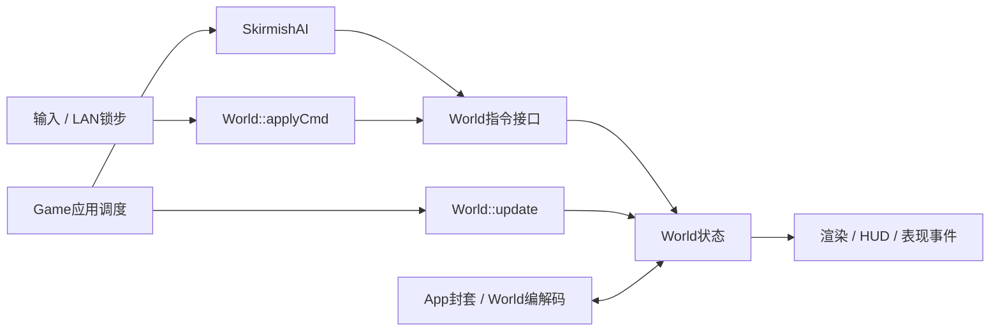

# OpenRA2 当前架构

本页描述2026-11-19收敛后的职责与合同。历史逐批记录原样保存在[旧架构记录](history/architecture-through-2026-11-18.md)，不作为当前版本依据。变更范围及验收见[收敛审查](convergence-review.md)，开发方式见[开发流程](development.md)。

## 运行依赖与执行顺序

项目使用C++23、raylib 5.5、Lua 5.4.6和CMake。`Game`负责应用流程、输入、任务/AI调度、存档封套和界面；`World`拥有确定性模拟状态及实体生命期。`SkirmishAI`通过已有World指令入口控制单位。原始事件、队伍脚本和生产执行作为World的子系统运行。

模拟按逻辑tick更新，随机数、指令顺序和实体身份参与确定性约束。显示帧、音频与表现事件不驱动模拟。顺序校验、二进制保存和渲染派生数据各有用途；不要通过复用一个序列化器改变历史校验字节。

生成地图的软迷雾遮罩每六个逻辑tick刷新一次。`bakeFogMask`按固定宽度的菱形扫描行填充遮罩，重叠时取最深一档，未覆盖像素全不透明。地形投影、迷雾不透明度和双线性采样决定实际显示，原生地图继续使用它的地形遮罩缓存。

World仍是中央状态对象，许多字段对内部子系统公开。此次分拆建立了职责和写入入口，没有将它改写成ECS，也没有完成所有字段的访问封装。

普通遭遇战和联机入口默认选择RA2来源规则与美国，融合和YR可从规则选择器进入。RA2规则来源为`ra2-local-base`。读档与重开使用保存的规则和国家。Scene63及更早的RA2规则通常写World64，离位或等待寻路时的指定回厂使用World65，已经驶往或等候指定精炼厂的武装矿车写World66。新的武装矿车入泊或转向离位状态写World67，运行中的二次宽弯写World68。超时空矿车待传送至泊位或尚未转东就收到离位命令时使用World69，正沿地面路径为同厂出泊矿车让位时写World70，保留第一个卸矿周期的启动帧时写World71，武装矿车等待按定速离位时写World72，等待或正在加速出泊时写World73。活动三次宽弯使用World74；存在显式乘员归属时由World75携带上述基础布局；活动地面卸载使用World76，记录基础布局、归属块与任务。当前Scene68继续以World77封装上述主体、可选归属/卸载块及建筑出售历史。联机协议为LAN96，App封套为11或12。覆盖融合四阵营或早期World格式的回归夹具显式选择融合规则，正常菜单输入回归使用RA2默认开局。

生成地图的抢地盘出生区由`world_initialization.cpp`在创建初始部队前选择。各家使用实际规则的建造厂脚印，保留可通行的护卫位置与互不重叠的出生区；不改地形、不额外增加单位。Game只应用模式的全图揭示和补给箱选项，不再在World初始化后挪动基地车坐标。普通Battle与作者地图的出生流程不变。

菜单和结算遮罩先接收输入，本帧隐藏HUD不再处理鼠标按键、键盘和侧栏滚轮。帧开始时已经存在的遮罩会占有整帧事件，点击“继续”后也不会把同一个点击传给HUD。该路由状态只属于Game表现层，不进入World、存档或网络命令。

鼠标默认使用经典左键发令、右键取消，可在设置中选择现代右键发令，并写入本机`settings.ini`的`classic_orders`。经典模式的潜在指令在左键松开时判断：大拖动执行框选，小拖动执行已有智能命令；松手落在HUD则取消该次指令并保留选择。友军普通点击仍可切换选择，进入/维修等动作沿用原准入。此路由复用相同World命令，不新增模拟、App保存或LAN字段。

联机握手安装World后，与普通开局一样准备当前地表、预载本地素材并按新地图钳制相机。首次联机和从其他地图进入联机都重建表现数据；准备地表与绘制开局不改变模拟校验值。

灰熊、犀牛、天启、光棱、幻影、磁能坦克、坦克杀手和盟苏矿车使用32个按需缓存的VXL朝向。车体与独立炮塔共享覆盖所有朝向的物理模型原点；点选使用当前显示姿态的包围盒。Scene45的来源地面车辆使用`native_ground.h`保存两套16位方向计时，`world_native_ground.cpp`由原始ROT、目标角度和逻辑时间推进；90度/ROT5为12原版帧、24项目tick。跨零点和半途改向按实际本地原程序FacingClass的整数除法顺序处理。移动的大转角先原地转向，小转角允许原有轨迹继续；开火沿用既有射界，但判断实际计时角度。Drive的同层同高度直角宽弯已有位置和朝向采样。其他弯道与完整原版射界待进一步校准。渲染只读取角度和上一tick的表现快照；表现快照不保存、不入checksum。旧来源规则继续原有八方向逻辑和显示插值；SHP步兵、特殊来源模型、IFV、飞机与部署动画保留各自绘制路径。

地面车辆已启用计时转向时，首发和连发都使用开火时的16位车头或炮塔角度。续发已就绪而目标超出射界时，下一发继续等候正常瞄准。

Scene47在普通RA2单位定义中保存原始`Crusher`和`Crushable`。`world_pathing.cpp`的重寻路与占格处理共用同一个资格查询，按类型标志决定能否碾压步兵。盟友、无敌、定身和不同移动层仍按既有准入保护；RA2部署大兵使用本类型的`Crushable`。本机原版构造默认值、INI读取和规则字段对照见`tests/fixtures/ra2-crushing-reference.json`。Scene46及更早场景、YR Scene43和融合规则保持原来的装甲/部署判定。新字段随既有嵌入场景保存并参与校验，缺失、越界或伪署旧场景均拒绝。World与App封套布局沿用原合同，当前未发布协议批次仍为LAN96。Scene48把死亡结算移到实际路径位移之后：只遍历当前位置同格同层的可碾压步兵，水平距离平方严格小于半格平方时结算。转向、预约、受阻和停止本身不杀死步兵。物理路径查询可放行这些步兵，车辆接近时允许暂时同格；传送、落地和让位查询仍要求空格。同格多个接触目标采用世代引用快照，死亡回调后重查移动者与剩余目标。Scene47保留原入格前触发方式。Scene49仅在实际路径查询中，让步兵继续在已经占用的同格同层内移动，不再因原格里停住的车辆而卡住；其他步兵仍计入原有容量，新格、其他查询层和非路径查询保持阻挡。原版Walk的Process、Movement_AI与坐标提交隔离执行见`tests/fixtures/ra2-infantry-sharing-reference.json`。Scene48保留原来的格内阻挡，未增加World/App字段。原版函数的13组隔离执行与静态调用点见`tests/fixtures/ra2-crush-contact-reference.json`；原版整帧调用节奏、警告让路、主动碾压、军衔能力和其他死亡演出尚未校准。

接触碾压直接移除步兵，不再创建普通Die1倒地特效；仍走公共死亡清理、脚本回调和实体退役，保留碾压音效与单位损失提示。原版销毁登记、Infantry/Foot Limbo和Foot/Object UnInit的13组隔离执行及限制见`tests/fixtures/ra2-crush-death-reference.json`。这是表现修正：只减少既有Effect记录，不改单位状态、RNG、碰撞、校验值或编码布局，该表现批次未要求改变Scene49/Production9、World64..74、App11/12或未发布LAN96。读取旧档时保留其中已编码的倒地特效及剩余寿命；Scene47及更早的旧触发路径保持原样。

Scene50增加`NativeCrushWarning`中的PlayerScatter、ComputerIQ与ScatterIQ，以及单位的Fraidycat。配置从嵌入来源场景恢复，缺字段、越界值和伪署旧头部拒绝。`world_native_movement.cpp`建立新的Drive/Ship节点时调用预警；复用已经保存/校验的节点身份，续档不会重新采样同一段。按同格同层世代引用快照处理步兵，精英格先整体判定，普通正在移动者保留路线，Fraidycat可在移动中散开，人工部署步兵拒绝自动散开。空来源坐标按步兵格内位置或朝向，加一次[0,4]随机偏角，轮询八个邻格。实际移动复用原有准入及控制器清理，自动反应不播放玩家移动确认音。Scene49及更早不启用此规则。Scene50是独立的模拟变化，但不增加World/App字段；Production9、World64..74、App11/12与未发布LAN96沿用，来源规则指纹区分50与旧包。原版完整帧调度、桥面与寻路细节、RNG流一致性仍未证明。

冻结的实验AI导出仍使用Scene41 / Production5。`source_ai.py`剥离普通规则中后增的碾压资格、`NativeCrushWarning`及Fraidycat字段，再由原生旧合同严格解码；不把实验AI升级为普通遭遇战规则。

Scene51增加普通Drive被同格同层友军静止步兵阻挡时的强制散开，区别于Scene50的普通入格预警。原版`Unit::CanEnterCell`在平地夹具中将该占用归为6，正常Drive准入入口的该分支直接调用格内散开，忽略玩家/IQ门槛和人工部署保护；普通正在移动的步兵仍可拒绝。`world_pathing.cpp`在既有物理阻挡分支调用`scatterBlockedInfantry`，先完成车头对正，再通过`scatterInfantryCell`共享邻格选择和无确认音的移动准入。此分支不要求Crusher，只处理本批已确认的全友军步兵占用；混合敌军、车辆阻挡和其他机车不借此强制移动。冻结、部署转换、建筑和移动层边界保留。Scene50及更早续档不启用该分支。来源场景号与规则指纹区分51；Production9、World64..74、App11/12和未发布LAN96不变，没有新增编码字段。原版完整重试节奏、混合占用与整帧调度仍待校准。

Scene51同时修正本项目交通控制的原地等待点互锁。在既有退路出口重选分支，阻挡车辆已经到达临时等待格中心时，局部`reciprocalMovementCell`查询越过连续的同格等待点，识别实际离位步；仍在靠近等待格或偏心回正时保留原节点。其余冲突匹配和准入入口沿用既有逻辑，实际移动仍执行原路径，复用合法退让、原终点和每tick八次寻路预算。Scene50及更早保留字面下一节点的旧判断。这是本项目交通死锁修正，不作为原版AI或寻路一致性证据。

Scene51还区分裂缝的远程遮蔽与实体实际观察。`revealLocalSight`复用实体的既有视野和实际侦察机观察；`applyGapShroud`处理完所有有效裂缝后，仅为受到遮蔽的玩家恢复这些局部观察。共享视野开启时才恢复盟友的局部观察，不传播盟友的卫星照亮。卫星单独照亮仍被遮蔽，观察者离开后该区重新成为未探索；低电和敌我判断沿用原规则。Scene50及更早保留直接覆盖的旧结果。此修正不增加字段、命令或格式；同一未发布Scene51/LAN96整批更新。这里修复本项目内部的观察一致性，没有执行原版逐格雾更新；后续Scene52只校准平地覆盖集合，高程和刷新时序仍未校准。

Scene52校准普通RA2零高程覆盖，沿用Production9。本机原版`GAGAP`的`GapRadiusInCells=10`；执行原始激活/移除循环，在平地内部取得373个实际写入格。其边界是`dx²+dy²<(R+1)²`，旧项目的`<=R²`只有317格。`world_fog.cpp`仅在Scene52+使用该边界，继续使用原有建筑原始锚点、固定半径10、敌我/供电判断和Scene51局部观察恢复；Scene51及更早保留旧覆盖。实际记录为`tests/fixtures/ra2-gap-radius10.csv`，出处与隔离依赖见`ra2-gap-reference.json`。原版地图查询、盟友谓词和表现失效通知由夹具提供，单位实际视野收集、非零高程、真实地图边缘及完整帧/渲染流程未校准。来源场景和规则指纹隔离这次模拟变化，World64..74、App11/12、未发布LAN96及命令载荷不变；YR仍为Scene43/Production6。

Scene53引入地面高度裂缝查询，沿用Production9。原程序地面格坐标的XY不随高度预移，Z每级104；裂缝先写入投影雾格，地面查询再按目标高度取一格或相邻两格。偶数高度使用单格，奇数高度须两格都被合并后的裂缝场覆盖才遮蔽。`world_fog.cpp`为各玩家累积两个查询点的覆盖位，再统一解析；不能先逐个裂缝解析成地面遮罩再取并集，原版对角重叠记录有七个反例。候选范围由当前地形高度界限推导，临时位图不进入存档。Scene52及更早保持原锚点和覆盖规则，Scene51的局部观察恢复仍在所有遮罩之后执行。来源证据为`tests/fixtures/ra2-gap-height-reference.json`及两份捕获CSV；21组配置包含零高程、奇偶高度、高差交界和重叠。原始查询在提供的平坦格上测量0..14级，另含15级边界控制；原生地图仍拒绝大于14的高度，未放宽解码。坡面细节、桥面/空中目标、实际视野收集、真实地图边缘及完整帧/渲染时序尚未校准。World64..74、App11/12、命令载荷和未发布LAN96不变；规则指纹区分53，YR仍为Scene43/Production6。

Scene54引入坡面中心的地面查询，沿用Production9，在地面查询中计入原版坡面中心的抬升。原版TMP帧0x2a字节经原始读取函数写入Cell.Slope；导入器把基础高度与NativeTileInfo.ramp分别保留，没有提前折入抬升。原始地面查询的315组输入覆盖基础高度0..14、坡面0..20：坡面9..16增加104 leptons，1..4及17..20增加52，其他类型为0；查询高度按104截断，只有9..16增加一级。`world_fog.cpp`用该查询高度同时推导候选范围和目标投影，裂缝锚点保持平坦源夹具已确认的算法。基础高度14的坡面可查询到15级，无须放宽原生地图高度解码。Scene53及更早不读取这项坡面抬升；既有ramp字段、World64..74、App11/12、Production9和未发布LAN96不变，规则指纹区分54，YR仍为Scene43/Production6。来源和限制见`tests/fixtures/ra2-gap-slope-reference.json`；原版隔离执行使用提供的格子和照亮标记，未执行完整卫星获取、视野收集或帧循环。格内其他位置的坡高、坡面建筑放置、桥面/空中目标及真实地图边缘尚未校准。

Scene55引入普通RA2来源运输的尺寸准入，沿用Production9。RA2来源单位运输按乘员Size、载具SizeLimit和已占尺寸总量准入；不再给履带车、夜鹰等额外套用步兵类别限制。HTK的容量5/尺寸上限2、DRON尺寸2已由既有导入器保存，此轮只改变`world_orders.cpp`的准入分支，不改这些数值。两台恐怖机器人加一名普通步兵占满履带车，第三台机器人被拒绝；IFV的尺寸上限1仍拒绝机器人。原版Unit radio15查询、真实尺寸求和及同盟判断的20组隔离执行见`tests/fixtures/ra2-sized-transport-reference.json`；对象操作的静态分支会发送该查询，未执行完整原版鼠标/装载帧流程。项目鼠标入口、路径、装载复查、载员转换和卸载复用既有执行链及ActorStateTransfer。空中/水面乘员、非同一所有者、已部署和控制器关联等原有限制保留；容器内乘员沿用现有归属语义，不据此声称原版所有权变化一致。Scene54及更早、YR43和融合规则保留旧准入。没有新增字段，World64..74、App11/12、Production9和同一未发布LAN96不变，规则指纹区分55。

灰熊、犀牛和幻影的炮口火光使用发射事件记录的炮塔角度与地面高度。独立炮管的末端用和炮塔贴图相同的体素变换投影，与炮塔姿态一同缓存。表现层按事件坐标绘制火光，炮弹和命中由 World 独立结算。

Scene44/Production7引入`HarvesterLoadRate`（支持1..1000个原版帧/阶段）；Scene45/Production8继续该合同。原程序默认2帧，采矿核心经过9阶段取一份矿，对应30 Hz项目默认36 tick。YR仍为Scene43/Production6；旧Scene37/43及缺省旧Scene42保留20 tick。采集方法与计时的隔离调用见`tests/fixtures/ra2-harvest-reference.json`。

正常采矿、卸矿返矿或切换矿点时，矿车进入目标矿格后开始采掘。重寻矿点和卸矿后规划路线时检查路径终点是否为矿格，无法到达时进入换矿、回厂或空闲重试流程。矿车因友方正在目标矿格采掘而受阻一秒后，可改驶附近有路线的空闲矿格。旧档已开始的采掘沿已保存的阶段续跑，下一次进入采掘时应用同格判定。

Scene45的矿车通过原有合法回厂指令接入`world_native_ground.cpp`：等候可用矿厂，接近+(4,1)，车头朝东(0x4000)后倒车进入+(3,1)泊位，卸完正向驶出。每厂同时只有一个世代绑定的泊位占用；出口保留给当前矿车，耗尽矿区后停在出口的空车通过既有交通让路流程移动。Stop/Move先离开泊位再继续，销毁、易主或外部瞬移清理预约并保留剩余货物。超时空矿车的原有回厂瞬移落在进出点后继续正常停靠，不据此声称完整ChronoLocomotion时序。默认卸矿门槛为15原版帧、30项目tick，每次处理首个非空资源类型的全部数量（矿石先、宝石后），空库存再经过一个周期后离开；精炼器按每类整批数量计算增益。原程序函数调用、坐标/朝向指令和528个角度样本见`tests/fixtures/ra2-ground-reference.json`，不是完整原版对局。

盟军超时空矿车与苏军武装矿车的行驶和卸矿姿态共用模型原点、贴图画布与阴影落点。姿态切换时以车体的世界坐标定位，点选读取当前姿态的实际边界。

计时卸矿在每批入账时核对货款接收方的电力。有效供电达到需求时计入矿石精炼器增益，供电不足时按基础矿价入账。需求为零按足电处理。每批正额入账的逻辑tick发出到账提示，联机客户端按入账玩家编号播放。提示是一次性表现事件，读档后从已保存的批次进度继续卸载。

`world_native_ground_save.cpp`在World63的Crew60后追加`GND1`有界块，保存已初始化单位的两套转向起点、目标、起始帧、时长，以及矿车阶段和矿厂世代引用；这些字段参与checksum。World61/62仍仅用于冻结全局AI，不将63误判为AIGL扩展。旧普通规则继续写World60，旧Scene44/Production7保留旧停靠、卸载及转向；App11/12仍通过暂存World后整体安装，错误扩展或头部组合不能替换活跃游戏。地图Scene42以`RulesBaseVersion=45`选择新RA2行为；地图封套自身不增加App字段。

地面矿车在进站格内重发回厂时，若仍在同一移动层上且离格心超过进站容差，返厂路线保留最后一段格内移动。Scene46武装矿车在进站点预约泊位，向西驶入。进入泊位格时请求朝东，在泊心且实际朝东后开始卸矿。触发格与本地RA2 1.08隔离无线电对照一致。对照使用给定格坐标，原版连续行驶轨迹与握手间隔仍待实机测量。

地面矿车规划返厂和执行停靠时共用矿厂可用性检查。矿厂被冻结时，已入泊的矿车先驶离原泊位，再携带剩余货物改道至可达的己方矿厂。

地面矿车和超时空矿车共用泊位地形检查。进站格和泊位须可通行，两格高差须在地面爬升上限内。矿车到达同一通行层的进站格中心后办理停靠。旧档中已入位的矿车遇到停靠条件不满足时，携货驶出后重新选厂。

矿车持有预约时，再次明确指定同一座仍可用的精炼厂会确认当前回厂任务。待执行的传送和实际停靠均从已有进度继续。超时空矿车等候泊位时，确认同一座精炼厂会记住玩家的选择，并按原计时再次尝试预约。在进站路上重新发出回厂指令可以重新规划路线，在泊位中指定另一座精炼厂时先驶离当前泊位。

进站格有车辆时，地面矿车先走常规让路和重寻路流程。路线耗尽后进站格仍被占用时，矿车优先选择可达且进站格空闲的同方矿厂。缺少可用替代路线时，矿车保留原来的回厂任务，继续等候进站。

武装矿车会记住玩家指定的己方精炼厂，并在寻路额度恢复后尝试规划路线。若当前泊位由另一辆矿车预约，它在原处等候并给泊位出口留空，车位腾出后继续进站。该选择在矿车驶出旧泊位后也有效，获得新泊位或失去目标时结束。自动回厂仍按可达性和空闲泊位选择精炼厂。

启用计时停靠的矿车卸完驶离时，从实际离位位置核对旧矿区的采矿路线。旧矿区被隔断时，从矿车所在地查找可达矿点，确定路线后开始下一趟。已在可采矿格时可就地进入采掘，找不到矿点时按空闲扫描周期重试。

同批固定自然对局暴露了固定翼飞机攻击移动的到达判定不一致：飞行已按0.4格容差到达，保留意图仍要求0.05格，导致侦察航段反复恢复。Scene45沿用飞行控制器已经作出的到达结果完成同一目的地的指令，不改变飞行轨迹、弹药或AI目标信息；历史场景保留原合同。泊位出口预约只约束其所在移动层，不阻挡上层桥面。

同一固定雪地图还暴露了多架慢速飞机重复执行相邻搜图航段。Scene45的普通AI将己方现有侦察目的地传给既有迷雾选区函数，分散新派航段；不保存新的AI状态，不读取隐藏敌人的位置，不改变原始AI或已接受的交战指令。历史规则保留原有选区。

Scene46在有效的履带车辆路径上选取同层、同高度的连续拐角。`world_drive_turn.cpp`用起终点都位于拐角格内的二次曲线连接直线段。弯行按实际弧长扣除速度累积量，换算率在相邻直段的直行与斜行速率之间过渡。车头进入弯道前按ROT对正，行进中的紧弯车头随弧线切线更新。World在每个tick开始时采样车体和炮塔角度，供渲染插值使用。碰撞、地形和交通预约由`moveAlongPath`准入与提交。履带车沿直线段行驶前先对正，剩余角度进入一逻辑tick的ROT转向额度后才平移。等待转向时清空速度累积量。新移动指令从实际坐标重新规划。若新路线仍走原出口，且出口与弯道同层同高，坦克会完成当前弧线，再接上新路线。改走其他出口会结束当前弯行。

两个正交步在同层同高并且出口可通行时，履带坦克可沿三次曲线从前一格格心驶到后一格格心。车头随弯道进度平滑入弯和出弯，移动量按曲线弧长扣除。原版1.08的两步轨道样本用于校准5度、45度、85度时的位置及整段距离。曲线参数到一半时，坦克在拐角格交接路径节点。两个阶段都在推进前检查单位占位和出泊矿车保留的进出格。已有障碍挡住出口时可走格内紧弯，途中遇到阻挡则按普通交通规则等候或重寻。

弯道按路径和地形规划。出口格被临时占用时，坦克仍可在拐角格内完成曲线并对正车头。进入出口格前会执行普通的碰撞、让路和交通准入，必要时先在弯道末端等待。

追击途中的定期重算也使用同出口续弯规则。新路线选中原来的同层、同高度出口时，拐角格留在路线首段。已经驶入拐角格的坦克可以继续驶到起弧点。正在弯行的坦克保留当前朝向和行驶进度，完成弧线后接上新路线。

玩家下达停止时，履带车辆结束当前移动和计时转向，分别保留命令执行时的车体和炮塔角度。两个角度沿用现有存档字段，后续指令从实际姿态启动。AI内部暂缓移动沿用其调度策略。

`World::applyCmd`接收的即时编队移动依据队伍中心到落点的八向航向排出方阵。`orderMove`先沿行进方向划分前后排，再按每排的侧向站位分配落点，同位时用实体编号决定顺序。地形、目的格预约和分层寻路仍会调整实际可到达的位置。AI、作者指令和追加路径点采用各自原有分配。Scene46履带坦克遇到同层同向并有下一步的己方履带车，可边等候边转向，最多等候90逻辑tick后回到原有堵塞处理。存档继续记录实际路径、转向和已等待时间。

单辆履带坦克在窄路弯中收到沿来路返回的指令时，可释放旧的通行方向。玩家在直线段下达沿来路返回的即时移动命令时，也可释放该方向。直线判断使用车体实际坐标到旧路线下一点的方向，坦克已经跨入下一格时仍能识别掉头。释放要求车道内只有这辆坦克、且尚未进入疏散阶段。下一次通行准入根据新路线选取出口，坦克对正车头后开始平移。

窄路内的退让路线被尽头格卡住时，恢复流程检查该步实际通行层的占位单位。找到双方下一步互相硬挡的友军后，可以改用另一出口并继续前往原目的地。步兵满格时会继续检查队首之后的占位者。车辆、步兵和桥面各自按实际通行层校验占位，退让仍使用普通路径和每tick寻路预算。

重发即时编队移动时，使用当前已分配的地面落点核对请求是否匹配同一组合法落点。已经停稳的单位可留在原位，正在行驶的单位须处于相同移动模式、目标层且路线未受阻。修改攻击移动模式、调整到其他落点或覆盖排队命令时，重新走普通移动准入。判定使用存档已有的目标、路径和单位状态。

泊位内矿车的编队落点以同层外侧格的连通区域筛选。移动路径从矿车的实际位置生成。矿车先由停靠流程驶到外侧格并释放预约，再沿获准的路径前往编队落点。

单位在目标格内重寻路成功时，`repathUnit`保留抵达格中心的最后一段移动。即使寻路结果没有格间节点，单位也会走完格内位移，再进入到达状态。

经典左键已有选中单位时，光标和命令分派通过`pickCommandUnit`判断单位目标。单位显示范围和同层实际占用格参与下令判定，主动选取和Shift加选可使用邻近命中。点击编队旁的空地仍走普通`Move`入口，联机沿用实体编号和世代绑定。

Scene46的超时空矿车通过`world_harvester_warp.cpp`预约单一泊位。预约绑定矿厂世代与实际落点，可跨越断开的地面路径。泊位 +(3,1) 可用并获准后，矿车在下一移动更新内直接落到泊位格心，保留起跳朝向，随后转东并开始卸矿。外侧格 +(4,1) 有车时仍可落在空闲泊位，卸完后按实际占位等待驶出。实际位移成对发出离场与到达效果，已在同层同坐标的矿车直接对正。落点、车头与已接纳后的节拍来自本地RA2 1.08的无线电、通行与传送函数对照。矿厂销毁、易主或新指令会释放预约，受阻时每12逻辑tick重试。直接落地后收到停止、移动或换厂指令时，矿车转东并先驶出原泊位。

Scene46的武装矿车与超时空矿车新进入泊内卸矿后，首笔整批入账在默认第32逻辑tick。随后每类资源和最后的空载检查各间隔30 tick。原版卸矿任务先检查计时，再推进同帧的阶段，实际首笔在第16原版帧。武装矿车正常卸空且准备返回仍有矿的原矿点时，在站内保留泊位，于空载检查后的第34个逻辑tick启动出泊。这个间隔采用本地原版隔离案例中空载检查到回采目标下达的17帧。原版回采调度含随机延迟，本项目使用该次测得的固定间隔。

武装矿车出泊时用普通Drive计算油门、速度和直行位移。减速距离以记忆矿点为终点。站内只向东驶向外侧格心，每次位移前检查实际占格和碰撞，受阻时丢弃当次位移余量。到达外侧格心后释放预约并按当前地图选路。若接回同一个矿点且同层直行，当步余量和速度可继续用于普通移动。原矿点缺失或采空时会重新找矿。停止、改点或矿厂失效会取消出泊驱动，按撤泊流程离开。原版平地校准使用真实回采寻路和Drive，夹具提供记忆矿点。

直接传送模式下，正在外侧格等候同厂的超时空矿车可以响应出泊矿车的让行请求。它沿普通地面路径驶向可用的空地，让位期间保留目标矿厂世代、货物和重试余量，路径结束后恢复回厂重试。前车到达外侧格并释放泊位后，后车方可传入。无可通行的让位路径时继续等候。

武装矿车还在进站格时可以直接改选精炼厂。占用泊位后，改点同方另一座精炼厂会中止本次卸货并先驶出。尚未朝东的武装矿车先在原位转东再驶离。World保留最后指定的精炼厂世代引用，驶出后按普通地面回厂或超时空回厂流程接近新泊位。已入账的矿石保留，剩余货物由实际停靠的矿厂卸载。停止、指定目标销毁和易主会取消该目的地。

World64在`GND1`后追加`TRV1`，记录当前弧线进度或正在回厂的传送阶段及剩余tick。矿厂身份沿用`GND1`内保存的世代引用。旧存档的传送准备与落地稳定状态继续使用原来外侧 +(4,1) 的落点和保存的计时。嵌入Scene45或以45为基础规则的地图通常写World63，其他旧普通规则写World60。World65在World63或World64数据后追加`DDR1`，按矿车记录离位或等待寻路时的目标精炼厂世代引用。World66沿用`DDR1`的记录布局，并允许武装矿车在进站阶段保留选择。World67用于新的武装矿车入泊阶段或尚未朝东的离位状态，沿用`GND1`和`TRV1`布局，随后写出可为空的`DDR1`。World68在存在活动二次宽弯时使用`TRV1`的第4类记录，保留同一份尾部布局及矿车状态。World69允许`TRV1`第5类的泊位传送记录及超时空矿车在泊位中心尚未转东的离位状态，可以同时保存宽弯。World70要求至少一辆等待直接传送的矿车有活动让位路径，沿用第5类记录和已有地面路径字段。World71要求至少一辆正在卸矿的矿车仍处于最初两个逻辑tick，沿用有符号卸矿计时字段，也可保存宽弯和让位路径。World72要求至少一辆空载武装矿车在泊心朝东等待离位，沿用同一有符号计时字段和尾部布局，可同时保存World71允许的活动状态。历史存档中已经开始的紧弯、进站对正和倒车入泊均按记录继续。读档核对路径、进度、泊位占用、命令阶段和实体身份。运行校验值覆盖轨迹类型与待执行命令。

World73要求至少一辆空载武装矿车在等待或执行Drive出泊。`GND1`记录新的离位阶段，原有移动记录保存油门、半帧和位移余量。World73也容纳World72及更早支持的同时活动状态。World72档按保存的等待计时归零后定速离位，正在定速离位的World64档继续当时的轨迹。

World74要求至少一段活动三次宽弯。TRV1第6类沿用已有弯道字段，类别参与校验值。World74可同时保存加速出泊、超时空回厂和先前支持的活动状态。第4类二次宽弯按原位置、朝向和速度继续，旧头的读取继续验证其对应的记录。

同批雪地图测试发现，残余部队可能留在地面无法到达的高地，空中侦察原先会先飞向所有未探明格。Scene46的武装空中侦察会优先复查已经看过、至少一分钟未观察且与己方地面部队地形不连通的陆地。选区依据己方迷雾、已派航段和地形连通性。

Scene56引入普通RA2乘员归属合同，沿用Production9。实际Board进入单位运输载具时，`GarrisonedUnit.player`保存乘员归属；`-2`表示历史记录继续继承容器，`-1`表示中立。`World::changeActorOwner`在普通运输载具易主前固定继承记录的原归属，普通乘员（含原生IFV炮手）继续归原玩家。卸载和临时乘员投影按记录解析归属，嵌套IFV及其炮手分别保留归属。驻军与舰载机生成存储维持各自已有合同，登车仍要求同一所有者并保留控制器/寄生准入。Scene55及更早、YR43和融合规则继续旧归属行为。

显式归属使用World75保存：八字节magic后增加int32基础布局号64..74，随后写出该旧布局的完整主体和扩展，最后追加`COW1`块。该块为uint32记录数、按实体槽位/cargo先序/garrison先序遍历的int32归属、uint32载荷长度（8+4×记录数），总计不超过1000000条。遍历包含死亡槽位；显式归属也按这个历史范围参与独立checksum贡献。没有显式归属时仍写原World64..74且不追加归属checksum。基础号区分二次TRV1 tag4与三次tag6，不能把75视为74的别名。未知基础号、越界所有者、错署旧场景、计数/长度损坏或尾随数据在Game的暂存载入边界拒绝，不替换活动游戏。App11/12与未发布LAN96沿用，规则指纹区分55/56。

原版依据为`tests/fixtures/ra2-cargo-ownership-reference.json`：四组隔离执行经过Unit→Foot→Techno易主链、原始AddPassenger及列表出队，普通及实际Gunner标志路径的乘员都不易主。原始AddPassenger读取Gunner，调用Unit炮手绑定与模式选择；给定乘员模式3能被实际写入，Unit+0x5b0始终为空。早期给定的特殊指针最初被误称为炮手，后由Unit数组恢复路径排除该解释；该探针仍保留供审计。夹具供给已Limbo的Foot对象切片、空模式表和外围依赖，未执行实际Infantry构造/机车Limbo包装、心控/物理卸载任务或原版整帧循环。当前实现的完整命令流程与原程序隔离证据分别记录。

## 模块边界

| 模块 | 负责 | 修改时保持 |
|---|---|---|
| `game.cpp`、`game_logic.cpp`、`game_*` | 应用生命周期、模式、UI、AI与任务调度 | 图形/音频初始化与模拟分开，正常UI和测试共享真实应用流程 |
| `world.cpp`、`world_update.cpp`、`world_*` | 实体、移动、战斗、经济与原始规则子系统 | 实体世代、顺序、占位、失效引用和完整tick不变量 |
| `world_commands.cpp`、`world_orders.cpp` | 命令路由、身份过滤、动作准入及回执 | AI和用户复用合法性检查，不绕过资金、寻路或保护状态 |
| `world_ownership.cpp` | 既有实体易主的共同不变量、建筑整批同步 | 保留控制器清理和任务生产时序；创建/解码与易主分开 |
| `world_checksum.cpp` | 确定性模拟校验 | 保留历史字段顺序、版本条件和持久化/派生数据边界 |
| `world_save.cpp`、子系统 `*_save.cpp` | World主记录与有界扩展块 | 旧字段顺序、长度限制、身份解析和原子恢复 |
| `game_save.cpp` | App封套、任务/Lua/AI状态暂存与提交 | 所有部分验证后才替换运行游戏，失败不破坏当前游戏 |
| `ai.cpp`、`ai_*` | 遭遇战策略、侦察、建设、生产、运输与进攻 | 根据本方可知信息决策，用World指令执行 |
| `world_native_ai*`、`world_native_teams*` | 原始AI合同、局部/实验全局任务与队伍执行 | 不以局部实现替代完整原版行为，不自动提升实验规则 |
| `gfx/`、`sfx/` | 资源、实绘与声音 | 渲染不修改模拟或RNG，基础资源缺失明确报错 |
| `net/` | TCP帧、规则握手、锁步与校验 | 不同模拟协议拒绝混联，延迟命令使用世代身份 |

## 共享原语与政策差异

`actor_state_transfer.h`统一乘员的持久属性捕获与恢复。它不复制坐标、路径、即时所有者或控制器链接；登车、卸载、舰载机和重生调用方仍处理这些上下文，以及既有生命值/经验约束。

`actor_contents.h`按既有顺序访问存活根实体及嵌套cargo/garrison，并按各乘员解析后的归属过滤玩家，用于生产限制、任务单位计数等只读查询。异主载具中的乘员仍计入自己的玩家；死亡槽位不计入。`visitStoredPassengers`供持久化及其归属checksum使用，包含死亡实体槽位，编码前使用独立的深度/数量验证。

`core/binary_state_io.h`提供有界二进制原语和既有模式的轻量适配器。各子系统仍拥有自己的字段合同、合法性验证和校验过程。共享IO不意味着任意旧版都可以忽略字段或自动迁移。

`production_work.h`提供普通固定工作量以及来源54期付款/进度的执行原语。来源普通队列和关卡AI工厂共享后者与既有`spawnFromFactory`，但调度、暂停、队列容器及价格政策不同：普通队列保存报价，本地关卡任务保留原有价格规则。

`World::changeActorOwner`用于已经存在的实体易主，保持实体世代，清除旧所属方的保留进攻意图，并同步已建立的原始闸门归属投影。调用方仍负责心控链接、返回归属及专用清理；建筑批次在原逻辑边界调用`synchronizeBuildingOwners`。关卡工厂失效任务仍在原生产阶段取消，不能随意提前取消时点。

## 合同与兼容

定义版本、World格式、App封套和LAN协议是不同维度。当前权威位置如下：

| 内容 | 当前写出/选择 | 权威位置与读取边界 |
|---|---|---|
| 普通来源规则 | RA2 Scene68 / Production11，YR Scene43 / Production6，共用Crew2 / Temporal1 / Weapons3 / IFV2 | 安装规则包与`world_native_scene.cpp`，作者关卡用Scene16；Scene60要求进入载具所在格后装载，Scene59允许既有同盟关系下的登车，Scene58校准出口与离舱移动，Scene57逐名调度卸载，Scene56保留普通运输乘员的独立归属，Scene55按尺寸准入来源地面乘员，Scene54计入坡面中心抬升，Scene53按基础地面高度解析合并裂缝场，Scene52保留原锚点覆盖，Scene51保留旧覆盖并增加友军步兵阻挡时的强制散开，Scene50保留普通入格预警，Scene49保留无自动预警的离格修正，Scene48保留格内阻挡，Scene47保留提前触发，Scene46保留旧资格判定 |
| 原版遭遇战地图 | Scene42，基础规则显式为37或43..60 | `native_scene_contract.h`绑定地图id、源hash、nmap字节hash、原始出生点和中立场景物件 |
| World | RA2新规则64，指定回厂65或66，新入泊或转向离位67，活动二次宽弯68，超时空矿车直达泊位状态69及让位状态70，卸矿启动71，站内等待定速离位72，活动Drive离位73，活动三次宽弯74，显式乘员归属75并记录基础布局64..74，活动地面卸载76独立记录基础布局、归属块标志和任务，Scene45为63，其他普通60，实验全局AI61/62 | `world_save_format.h`集中识别World6–76的71种magic，具体内容组合另行验证 |
| App | 11；原版遭遇战地图12 | `application_save_format.h`定义6–12封套；原版地图使用App12/MSET2保存地图id，其他入口保持App11/MSET1；6只支持下述已验证组合 |
| LAN模拟协议 | 96 | `net/net.h`校验双方模拟版本与有效规则 |
| 实验全局AI | 默认关闭，最新Scene41 | `native_ai_contract.h`的不可变表，见下表 |

| Scene | AI | Events | World | AIGL | 整体房屋控制 | 原版附近格 | 源坐标/查询填充 |
|---|---|---|---|---|---|---|---|
| 38 | 2 | 5 | 61 | 1 | 否 | 否 | 否 / 0 |
| 39 | 3 | 6 | 62 | 2 | 是 | 否 | 否 / 0 |
| 40 | 4 | 7 | 62 | 2 | 是 | 是 | 否 / 0 |
| 41 | 5 | 8 | 62 | 2 | 是 | 是 | 是 / 32 |

AI和Events持有不可变合同引用，能力由合同派生；不再同时保存可相互矛盾的可变布尔值。引用本身不进入文件。历史Scene38–40保留原合同，未知混合明确拒绝。实验全局AI没有替换普通策略，完整脚本和时序保真仍有缺口。

原版遭遇战首批仅接入`mp08t2`和`mp15s4`，支持RA2/YR规则的Battle/FFA。`skirmish_map.cpp`加载原始地图元数据，将普通规则和中立场景物件组合为Scene42，保留雪谷的船厂TechLevel覆盖。`World::init`先安装场景物件，再在原始出生点创建正常部队；定义恢复只解析初始物件记录，读档不会重新生成已摧毁的物件。地图复用既有地形、定义和实体字段。App12必须携带匹配的MSET2地图id和Scene42；错误封套、缺失地图或不匹配的规则组合在替换当前游戏前拒绝。重开使用保存的规则/出生点/物件定义和对应原始nmap，校验nmap字节hash。地图预览只读取素材，不更新模拟或RNG。局域网使用程序地图。

原版地图自然对局固定使用`mp08t2/seed922/2方`和`mp15s4/seed923/4方`，普通难度、10000资金、关闭补给箱，观察窗口180000tick。终局World/App与遥测保存在当前构建的`original-skirmish-natural-audit`。用`ra2_regression --original-skirmish-regression <新输出目录> <World或App文件>`只读导出实体与AI记录，供失败定位；这不是自然对局通过证据。空中侦察仅从原版地图的实际存在格选择目的地，排除正方形存储画布中的空白区。

普通AI的空袭优先选择已记录、当前可见且武器兼容的战略建筑；保留已经开火的攻击、追击建筑和返航补弹。目标只来自本方实际视野和记忆，通过既有World指令执行。原始跳跃飞行单位按飞行控制器的到达判定结束对应的攻击移动，再执行后续航段，避免基洛夫停在已到达格反复恢复同一指令。物理飞行速度和轨迹保持原有实现。

Scene47普通AI的气球悬浮轰炸机仅把自身视野或武器射程内的移动单位作为战术目标；远处友军观察到的移动诱饵不再抢占侦察。已接受的远处移动追击可以恢复正常迷雾航段，正在开火、近处追击及建筑追击继续执行。全图没有待侦察区域时，仍可追击远处可见残敌。`nativeRulesBaseVersion`由嵌入来源恢复，包括Scene42的基础规则版本，供该调度选择合同；它不另加保存字段。旧场景、YR、融合与实验原始AI保留原调度。此项修复来自固定雪地图失败现场与独立机制复现，属于本项目普通AI策略，不代表原版AI行为一致。

普通地面AI在没有当前可见目标、也没有可推进的基础设施目标时执行迷雾搜索。小队保留两支侦察；较大部队按每六个地面战斗单位一个搜索名额、最多八个分区推进，并根据本方已有指令避免重复覆盖同一视野区域。已存在的移动和近距离交战不会被该搜索调度覆盖；隐藏敌人的实际位置不参与选区。

Scene43/NativeProduction6引入原始矿石/宝石单价，后续普通规则继续使用本地来源25/50。CMIN满载普通矿500、宝石1000，HARV分别1000/2000。旧来源快照默认保留35/70；Scene42缺少基础版本按37解释。原始库存估值与房屋入账函数的隔离调用证据在本地`miner-calibration/original-proof.json`；实验Scene38–41继续Production5。采集、停靠与整批收益的后续版本分别见上文；各版本读档不会自动升级。

GAME6支持限定为`mission=-1`、`wave=0`、`localPlayer=0`、无任务触发器/目标/脚本、嵌套World29的遭遇战封套。已用真实用户备份验证读取、App11另存和300tick重复；未知旧档组合继续拒绝。转换不得覆盖原件。实际核验使用`ra2_regression --app-state-test`，并显式提供`OPENRA2_LEGACY_APP_TEST_INPUT`与`OPENRA2_LEGACY_APP_TEST_OUTPUT`。

## 构建与测试隔离

`ra2_runtime`静态库包含产品运行代码；`ra2`链接它提供正常游戏。`BUILD_TESTING=ON`时另建`ra2_regression`和小型纯逻辑测试程序。`RA2_TESTING`只控制回归可执行文件的分派，不进入运行库对象。ON/OFF配置的核心编译输入相同。

诊断方法位于`tests/game_regression.h`的`GameRegression`，利用友元访问执行真实应用流程，相关实现只链接进回归目标。`*_tests.cpp`、`game_regression.cpp`和`game_live_verify.cpp`不进入产品库。产品`ra2.exe`在初始化游戏前拒绝测试标志，测试和截图命令使用`ra2_regression.exe`。

`ra2.ground_control`核对停靠、转向、战斗、生命周期、续档与渲染。`ra2.ground_travel`使用合法指令验收弯行、传送落点与物理停靠，并在运行中保存和逐帧核对回厂及重新采矿。45度弯道用实际位移检验直斜衔接。直线起步、行驶中改向和窄路掉头检查车头角度与实际位移，弯道交接和停止后的姿态分别检查续档。`ra2.group_orders`实跑八个方向的移动和攻击移动，检查不同选中顺序的轨迹及中途续档。`ra2.classic_input`通过鼠标输入复验框选和重发编队命令。联机生产测试通过真实大厅、侧栏与TCP执行建造、暂停、继续、退款、放置和出兵。菜单和输入测试覆盖遮罩、经典及现代控制、联机命令队列和设置保存。接收端和World共用生产类型查询，接受融合枚举与当前来源类型编号。资金、科技及工厂准入在命令执行时判断。LAN96同步武装矿车从卸空等待到加速离泊和直行续驶。

`tests/verify.py`会构建、检查实际执行集合，并记录二进制与代码/配置哈希。完整检查、ASan与构建ON/OFF各自报告；命令和停止条件见[开发流程](development.md)。

Scene48接触结算批次的最终验收为182/182完整Release与9/9相关ASan。ASan之后只修正两处Python资源版本断言，原生代码保持不变，各构建的二进制哈希也保持不变。28份本次重新生成的World/结果文件逐字节一致，Scene46和Scene47各14组旧档保持600tick完整结果。两张固定原版地图分别在32,589与150,467tick自然结算，均保留原180,000tick窗口和精确App12检查点。完整记录为`review_out/ra2-crush-contact-20261123/acceptance-audit.json`；首轮两处旧断言失败与夹具失败均已保留。原版整帧碰撞调用、警告让路、死亡演出与人工实玩仍未验收。

Scene49离格修正批次通过182/182完整Release和4/4相关ASan，652份代码/配置输入完全对应同一版本。八向步兵离格及格内中途、下令后续演通过；定身、九组新格准入和其他查询层的阻挡保持。Scene46/47各14组、Scene48一组实际旧档保持原600tick结果。固定原版地图仍分别在32,589与150,467tick结算，保留原种子、180,000tick窗口和精确App12检查点。证据为`review_out/ra2-shared-infantry-20261123/acceptance-audit.json`。

碾压表现修正通过182/182完整Release和4/4相关ASan，653份代码/配置输入对应同一版本。八组600tick轨迹的4,808个校验值保持一致。91份新输出中85份与修改前逐字节一致；另外六份仅移除了八条Die1特效记录并更新既有数量，其余字节不变。最终定向、完整Release与ASan的91份输出彼此完全一致。28份下令存档/结果保持字节一致，29组历史场景结果与Scene49旧特效剩余19tick续播通过。两张固定原版地图仍在32,589和150,467tick自然结算，种子、180,000tick窗口和精确App12检查点不变。记录为`review_out/ra2-crush-death-20261123/acceptance-audit.json`；没有据此宣称其他死亡演出、原版完整帧调度或人工实玩已经一致。

Scene57引入普通RA2卸载计时合同，沿用Production9。地面Unit类运输（含两栖运输）通过`NativeTransportUnload`保存来源`[Unload] Rate`换算的14帧基数及原任务固定的0～2随机帧、10帧移动等待和1帧准备间隔。Unload唤醒载具并登记任务；既有行进可以完成，准备后每次释放一名乘员，正常间隔28～32逻辑tick。重复Unload保持阶段、计时与RNG；获准Move/Attack/Stop/Guard/Scatter/Board取消任务，普通路径完成不取消。初始无出口结束任务；已经进入释放阶段后出口受阻则保留乘员等待重试。更新在可能产生实体后立即返回，以代际身份重新取回载具，退休时清除任务。空中运输、驻军、矿车卸矿、Scene56及更早、YR43和融合保留各自原路径。

活动地面卸载任务使用World76：magic后为int32基础布局64..74、uint8显式归属块标志0/1，然后写出该基础布局的完整主体和扩展、可选`COW1`及必需的`TUN1`。TUN1为4字节标记、uint32任务数、按EID升序的记录（int32 EID、uint64 generation、uint8 phase、int32剩余tick），最后为uint32载荷长度8+17×任务数。任务数必须非零且不超过实体数，实体必须存活、代际匹配且符合Scene57地面运输条件；阶段与计时严格有界。准备阶段要求有乘员，释放后空舱的收尾阶段仍须保存。只有存在活动任务时追加独立TUN1 checksum贡献；没有任务继续World64..75，不增加旧档checksum。World76的归属块与基础布局独立，不能把76当作75或74别名。损坏或不支持的组合在Game暂存载入边界原子拒绝。App11/12、Production9和未发布LAN96沿用，规则指纹区分56/57。

Scene57的该批时序来自`tests/fixtures/ra2-ground-unload-reference.json`：原版Unit::Mission_Unload与实际MissionClass::AI计时器在三个种子下均每次只释放一名，原始队列在首名释放后接收立即Move并留下两名乘员。项目规定命令后下一tick首次派发，静止夹具于第5tick放出首名；这是明确的项目输入对齐，不是完整原版鼠标时序证明。Scene57保留原有出口搜索、车体朝向与离舱后行为，Scene58的更新见下文；原版物理Unlimbo、真实转向进度及完整帧调度未校准。

Scene58引入运输出口与朝向合同，沿用Production9。地面运输的准备阶段按原始Unit出口查询遍历八邻格：有效/无效格以128/-128起分，减去有符号八位朝向差，南向额外减100；同分保留先遇到的方向，最高分必须大于零。普通载具请求朝向选中出口的反方向，`IsTrain`保留当前量化朝向。该字段从原始TechnoType+0xaa0的INI绑定确认；只校准本项朝向分支，不代表列车运动已实现。准备后沿用Scene57的计时与转向等待轮询，实际车体转正后再进入释放阶段。

Scene58释放只在相邻格物理恢复乘员。第一轮从车后开始顺时针查八个方向，近格与同向第二格均可用时，在近格生成并通过既有orderMove前往第二格；第二轮从偏移1开始，只要求近格，目的格改为近格。正后方的偏移0不进入第二轮，这个边界来自原始分支和捕获，不能简化成重复扫描全部八格。原函数还拒绝近格带桥梁标志的放置。生成、ActorStateTransfer、归属、IFV模式与代际身份继续使用现有边界；普通移动指令负责离舱后的导航。

新场景复用GND1已有的车体朝向、起转时刻和持续时间，以及World76的TUN1任务阶段/计时；原始任务不另存选中出口，因此没有新增二进制字段或World77。World64..76及App11/12沿用，规则指纹区分57/58，同一未发布LAN96整批更新。Scene57及更早保留固定环扫描和原待卸任务续跑；飞机、驻军、矿车与冻结实验AI保持各自合同。`Type.*.IsTrain`只在Scene58普通规则中读取，冻结Scene41导出剥离该字段。

证据为`tests/fixtures/ra2-transport-exit-reference.json`及其两个捕获CSV：原版实际方向初始化、Facing.Current、出口查询、乘员列表、Unload和RNG执行，131072组出口和160组近/远格输入被记录。初始查询使用受控Foot地形代价与空占位，释放的CanEnterCell、物理Unlimbo和子格调整由依赖提供。项目的高度、占位、桥面和寻路仍采用自身模型；完整原版物理碰撞、步兵子格和鼠标派发时序不在这批证明范围。

Scene59引入同盟运输准入合同，仍为Production9。World::boardOwnerAllowed将登车所有者判断共享给entryRejection、运输光标、智能命令和经典输入上下文：相同所有者沿用原规则，新增普通规则按载具一侧对乘员一侧的既有同盟关系准入，负所有者不借此放行。鼠标入口先保留乘员方的敌对判断，因此对应原动作分支的双向条件。World::applyCmd仍只接收发令玩家自己的选中实体；借用运输不授予对载具的选择、移动或卸载权限。抵达时仍经entryRejection复查关系、容量和既有尺寸/部署/控制器保护。

登车复用Scene56的显式乘员归属与ActorStateTransfer，载具保持原主人，乘员卸载后恢复自己的玩家和持久属性；IFV炮手同样如此。没有新编码字段，World64..76、COW1/GND1/TUN1和App11/12沿用，未发布LAN96整批更新并由Scene59来源指纹区分。Scene58及更早、YR43和融合仍只准同一所有者。本批使用现有AI结盟关系，没有增加外交界面、同盟存储或共享单位控制，也不改变普通AI运输调度或冻结Scene41导出。原版14组查询/动作分支与4组实际乘员列表/炮手归属执行的依赖见tests/fixtures/ra2-allied-boarding-reference.json；动作从给定基础动作0进入尾部分支，不是完整原版鼠标时序。

Scene60引入同格运输装载合同，沿用Production9。单位运输的entryWithinReach先要求乘员与载具的XY格坐标相同，再保留原有地表高度和飞机落地保护。载机仍在空中时，entryPath保留原邻格接近范围，乘员在落地点外等候，避免占住严格落地查询所需的空格；落地后entryPath以载具所在格的格心作为寻路节点目标；它的小正搜索半径只排除其他格心，不是装载距离。真实移动步的占位检查只略过当前Board目标且仍经entryRejection获准的载具，其他单位、地形、建筑、桥层和非物理查询继续原规则。实际移动后以实体世代、Board状态和同一目标复查，再经相同准入及接触查询装载。完成入口沿用completeEntry、ActorStateTransfer、普通死亡槽位清理和IFV炮手刷新。

Scene59及更早、YR43与融合继续原1.6格单位进入范围；建筑进驻与吸收入口保持原合同。新规则由Scene60来源全文及既有规则指纹隔离，同一未发布LAN96继续沿用，没有新增World64..76/COW1/GND1/TUN1或App11/12字段。原版依据tests/fixtures/ra2-transport-boarding-reference.json包含选定Infantry/Unit转移分支、原始坐标转换、消息准入和列表/Gunner操作的200位置样本及11个前提对照；外围命令协商、完整物理机车、桥/空军调度与原版整帧时序不在该隔离探针内。

同一未发布Scene60批次还修正普通AI空中侦察的孤立地块排序：在己方现有地面战斗单位无法连通的可通行地形中，未探索地块和已到重访期限的地块处于同一优先级，并按已有scoutObserved实际时间排序，再比较距离。未探索时间为零；既有60秒重访期限、其他侦察机目标间距和地形连通分类不变。它只使用己方雾与观测记录，不读取隐藏敌军。Scene59及更早继续旧排序；冻结来源AI与作者任务调度不变。复用既有App11/12 AI知识字段，没有新的World/App字段。这是本项目普通AI的覆盖修正，不是原版AI复刻结论。

Scene61把普通RA2建筑扳手维修改为来源步长、全局帧相位及逐步收费。Production10增加BuildingRepairFrames、BuildingRepairStep和每个生产类型的BuildingRepairCost；单位类型的费用为零，建筑费用必须为正。默认每14个原版帧、即28逻辑tick补8HP；新命令不重置相位。费用来自原始BuildingType造价（扣除赠送单位，按SeparateAircraft保留停机坪分支）及TechnoType维修公式，先进行两次整数除法，再按原版x87中保留的二进制64位RepairPercent乘积截断且至少收费1。默认15%的20倍仍略小于3，因此光棱塔每步收费2。尾笔不足8HP也收完整一步；资金不足关闭维修，补钱后需重新开启。

本项用于Scene61及以后有生产定义的普通RA2来源建筑。Scene60及更早、YR43、融合和作者场景继续原15tick、20格生命条及尾笔比例计费。低电、出售、时间冻结和指令准入沿用既有项目保护，不据此声称原版外围调度完全一致。规则全文及指纹保存新的派生费用与节拍；既有World64..76、App11/12和未发布LAN96无需新增字段，全局tick和repairing足以续演。原版55组隔离执行覆盖46种导出建筑与舍入、赠车、现金和尾笔对照，见tests/fixtures/ra2-building-repair-reference.json；完整原版鼠标输入、外围Building AI及人工实玩仍未校准。

Scene62 / Production11增加每个生产类型的BuildingSaleHuman与BuildingSaleOther：建筑为非负派生返款，单位必须为零；旧Production10及更早不得携带这些字段。原始非零Soylent直接覆盖两种返款；否则取扣除FreeUnit并保留SeparateAircraft分支后的BuildingType造价，普通人类再按RefundPercent截断，其他普通房屋取完整有效造价。本地国家建筑/防御造价乘数默认为1；不把此导出推广到任意自定义房屋倍率。HP不参与正常返款，盟苏精炼厂均为300，矿石精炼器为1250。

出售指令仍走applyCmd准入和现有selling/constructAnim；新Scene62不在下单时加钱，在updateBuilding现有动画结束/退役边界按当前所有者与普通人类/AI策略入账一次，然后走原kill清理。现有默认40动画tick在第41tick完成入账与退役；这只对应原版完成门，不宣称完整原版拆除时长已对齐。完成前被毁没有待付记录，易主走changeActorOwner及synchronizeBuildingOwners，中立所有者不收款。changeMoney沿用受保护返款及余额上界。

Scene61及更早、YR43、融合和作者场景保留下单即返原始造价一半的项目旧策略，续档不会再次发钱。World64..76、App11/12没有新字段；来源全文与指纹区分62及旧规则，同一未发布LAN96沿用。原版268组隔离执行及72条选定出售任务前缀见tests/fixtures/ra2-building-sale-reference.json；建造厂出售准入、幸存乘员、储矿清理、完整动画/鼠标时序不属于本批。

Scene63允许普通RA2建造厂走正常现金出售，并把该操作与MCV打包分开。World::constructionYardSaleEnabled是只读来源策略查询；applyCmd保留所有权/已出售等现有准入，出售工具和默认Delete快捷键按相同策略发送SellBuilding。MCV Repacks开关控制原Deploy及双击打包入口，Scene63出售不会替换为Deploy。盟苏建造厂用已有Production11返款：普通人类1500，其他普通房屋3000，HP不减款；沿用Scene62现有第41tick完成边界，不增加价格字段或独立计时器。

Scene62及更早、YR43、融合和作者场景保留原建造厂出售拒绝及旧输入改为打包的策略。历史回放用本次修改前实际输出，不能从当前夹具伪造旧行为。现有已付款建筑订单在最后一座工作建造厂出售后暂停，手动取消仍精确退款；这沿用项目调度合同，不声称原版工厂任务时序已完全复刻。World64..76、App11/12没有新字段，Production11和未发布LAN96沿用，来源全文指纹区分63/62。原版32组出售入口/任务前缀和独立打包查询见tests/fixtures/ra2-conyard-sale-reference.json；幸存乘员、完整动画/帧调度、储矿和原版完整MCV转换仍未校准。

## 建筑出售乘员与World77

Scene64 / Production11建立了以下出售历史合同。建筑创建时记录其初始房屋阵营；既有建筑通过changeActorOwner易主时永久标记captured，夺回也保留该历史。出售准入仅设置pending，第一次实际selling更新先清除pending，再尝试生成乘员；保留现有默认第41tick返款和退休边界。新单位通过spawnUnit取得正常世代、战斗身份及production身份，采用来源Unlimbo的固定朝向；不继承原建筑的占领历史。MCV重新部署仍创建新建筑。

World::releaseBuildingSurvivors拥有人数、兵种、落点与失败处理。原始Crewed映射为SaleCrewed，避免与驻军Crew前缀合同混淆；Engineer保留原布尔值。NativeSaleSurvivors1保存盟苏除数与四个步兵类型引用，不改变Production11。人数使用初始阵营、当前返款和captured；兵种使用当前房屋。工程师尝试占用本次出售的唯一工程师名额，即使分配/放置失败。来源地基随机格及格内三位置选择复用项目地形、占位和散开准入；生成过程中使用世代引用和建筑快照，updateBuilding在生成后重新取实体，避免vector扩容留下引用。已有散开循环先单独提取为逐实体原语，208份旧输出逐字节相同。

World77的8字节magic后为int32基础布局64..74和uint8扩展位（bit0 COW1、bit1 TUN1），随后为原基础主体、既有扩展、可选COW1/TUN1与必需SLS1。SLS1为4字节标记、uint32记录数、按EID升序的14字节记录：int32 EID、uint64 generation、int8初始阵营（-1中立、0盟、1苏、2其他）、uint8标志（bit0captured、bit1pending）；最后uint32载荷长度8+14×记录数。仅记录存活普通来源建筑，死亡槽位的该历史不参与后续行为。所有符合条件的活建筑必须有记录，pending必须处于selling；重复/缺失/错世代/越界记录拒绝。Scene64及以后必须使用此封套；更早来源不接受它。只在新来源增加SLS1 checksum项，旧checksum顺序与布局保留。

NativeInfantry追加在UnitType末尾，旧枚举值不变；CTECH的生命、武器、不可训练/不可生产策略由来源定义控制。实际CIV3动画由既有sprite bank生成；无原版cameo时，选中肖像使用其实际步兵图。来源原型语音使用CivAll组。此批没有实现战斗死亡飞行员/乘员，也没有声称原版整帧、完整地图Unlimbo或全局RNG相同。

## Scene65附近散开与出售离场

Scene65 / Production11引入以下附近散开合同。入格预警、受阻让路和出售撤出复用的empty-source步兵Scatter在原有资格检查和一次[0,4]抽样后，先以0～31格方环搜索完全空闲的格：横向递增交替检查上/下边，再纵向递增交替检查左/右内边，候选上限24，以native frame（World tick/2）对数量取模选中。此搜索不追加RNG抽样；无候选时保留既有八邻格回退。完全空闲与允许同格三名步兵的回退准入不同。原版529条查询的平地投影和矩阵对照见tests/fixtures/ra2-nearby-scatter-reference.json；高度相关的Tactical反投影优先层、全局物理机车/调度尚未校准，项目继续使用自己的地形、层和寻路准入。

处于正在出售的普通来源建筑内的步兵可以通过既有orderMove准入拆除后的路线：仅在一次只读Map/占位副本上去掉该起点建筑，其他建筑、地形、层与目标预约保留。实际moveAlongPath仍检查活地图，下一步还属于当前出售建筑时等待，清除后沿正常路径离场。Stop或新Move使用原有路径清理/替换，不增加延迟身份或模拟状态。新逻辑按Scene65准入，Scene64及更早保存结果保留。World77只携带现有path/goal/state，格式、Production11、App11/12与同一未发布LAN96均不变；规则指纹区分65。

## Scene65普通AI自动返修

World::serviceWorkStatus共享现有服务的工作条件：缺电等待、缺钱等待、正常工作、免费摘除寄生及完成/失败。它是只读产品查询，updateService的提取前后在同一实际现场续演1200tick的10份输出逐字节一致。普通AI只在可工作时自动送修，并释放AI房屋中已无法工作的返修；玩家房屋的等待服务保留。判断使用已编码的Player.isAI，反馈字段不参与模拟决策。旧Scene64和冻结/作者AI保留原策略。没有新字段或服务价格改变，仍为World77/App11/12及未发布LAN96。

## Scene66附近候选的高度投影分组

Scene66 / Production11校准了Nearby：按既有方环顺序累积最多24个合法候选；若某一完整方环后存在投影保持原格的候选，结束搜索并在该组内按native frame取模选择。全组被遮挡时继续跨环累积，达到24上限或搜索范围末尾后回退至全部候选。此前Scene65在首个非空方环直接选取，其旧存档继续保留该行为。

原版Tactical6a6a50对格心的基础高度查询可以等价为沿(+1,+1)检查六格：偏移k处相对基础高度达到2*k-1时会遮挡该格心。模拟仅查询已有Map基础高度，不调用渲染或消耗RNG；原有高度差、桥面/地面、占位及orderMove准入保留。原版0x1000来源标志对桥面额外高度的条件有单独供应位测试，但项目未证明该标志的映射，因此不据此改写桥面合同。World77/App11/12没有新字段，继续未发布LAN96，Scene66指纹区分语义。

## Scene67玩家步兵散开

普通RA2的X键继续入队既有、绑定世代的Cmd::Scatter，再由applyCmd过滤归属与身份。Scene67+的地面步兵改走scatterInfantry的Player策略：普通移动者、已部署者和现有定身保护拒绝改令且不抽样；站立与警戒者可以散开。移动Fraidycat在AI房屋或PlayerScatter开启的人工房屋中可获准，并以当前pathIdx的下一机车格搜索，而非最终命令终点。其他类型及旧Scene66保留各自算法。

Player、Warning和Forced明确区分；Drive受阻强制让路仍能请求起身，玩家X不复用该标志。辅助函数只返回准入结果，由调用者沿现有入口释放获准单位的控制器；自动反应逐个清理，手动命令交由applyCmd清理。Nearby仍使用Scene66的高度分组和既有地图/层/寻路准入，仅消费原有一次[0,4]抽样。没有新增存储、World/App字段或命令；Scene67来源指纹区分新语义，Production11和未发布LAN96沿用。

原版384条ScatterObject→Target/事件构造→队列→完整Event分发执行，加6条事件准入对照，见tests/fixtures/ra2-player-scatter-reference.json。原版规划615480和actor59c含义未映射，任务Scatter许可及老兵能力有供应边界；此证据不代表完整鼠标/任务调度、Walk、机车物理或RNG流一致性。

## Scene68玩家Unit车辆散开

普通RA2的地面/海军Unit继续走既有Cmd::Scatter归属与世代过滤，Scene68+转入独立scatterUnit策略。原版7072d0的empty,true,false分支直接调用Nearby，成功只设置目的地，失败立即返回；该分支不抽RNG，也不执行非空来源坐标的方向回退。复用已有nearbyScatterCell，其方环顺序、24候选上限、高度分组及native frame取模均保持；步兵仍保留独立的一次[0,4]抽样。

现有路径/路径点与含已准入移动目标的状态代表已有目的地；未结束车体转向、sleeping、Type.IsTrain、Teleport机车、活动nativeTransportUnload和已有移动保护拒绝改令。普通Guard允许散开，显式Stop结束转向后可再散开。获准动作复用普通orderMove及applyCmd控制器清理。Scene68的X不会取消活动地面卸载；Scene57..67仍保留原先获准Scatter取消任务的项目行为。

World77/App11/12没有新字段，仍为Production11与未发布LAN96，来源指纹区分68。Scene67及以前的车辆散开与实际续档保持旧算法；航空器、非空来源车辆反应、普通AI、步兵和自动散开均不变。原版0/6/16任务、IsTrain、COM机车标识与Facing计时器由真实指令执行；供应状态与未映射Sticky/5c8边界见tests/fixtures/ra2-vehicle-scatter-reference.json，不能推断完整机车/任务/规划时序。
