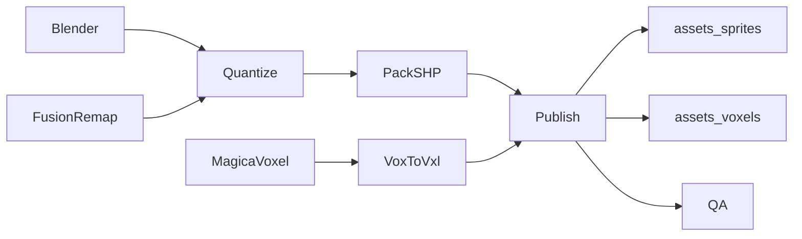

# Westwood 级 SHP / VXL 资产流水线

OpenRA2 支持两条资产路径：

| 路径 | 工具 | 用途 |
|------|------|------|
| **提取** | [`tools/ra2pack/gen_assets.py`](../tools/ra2pack/gen_assets.py) | 从本机 RA2/YR MIX 抽出官方素材 |
| **生产** | [`tools/asset_pipeline/`](../tools/asset_pipeline/) | 原创 / 融合兵种（本文件） |

二者最终都写入同一契约：`assets/sprites/`（PNG）与 `assets/voxels/`（VXL），引擎命名见 `gen_assets.py` / `vxl.cpp`。

### 菜单 / 对话框 chrome（主菜单·遭遇战设置）

从本机 MIX 抽出标题静帧与对话框按钮；主菜单视频解为 JPEG 帧序列（**不运行时解 BIK**）：

```text
python tools/ra2pack/gen_menu_gui.py
```

写出 `assets/gui/menu/`：
- 主菜单：`ra2ts_l/f####.jpg`（BIK 帧）+ 金字按钮素材
- 选项/遭遇战壳：`load.png`（`load.pcx`）、`multi.png`
- Allied 暂停鹰徽：`bkgdmd_*.png` / `bkgdsm_*.png`（`uibkgd.pal`）
- 控件：`dropdown_*.png`、`sdmpbtn_*.png`、`optbtn_*.png` 等
- 调色板/字体：`pal/*.pal`、`fonts/*.fnt`

缺素材时引擎回退程序化金属 GUI。**注意**：`fsbkgdsm` 是战役阵营徽记，不是选项页侧栏。

壳层页在 **640×480 逻辑画布**上拼装 `load.png` UV 槽位与 `sdmpbtn`/`optbtn`/`dropdown`/`pips`，再 POINT 放大 letterbox 到 1440×810（禁止把壳图直接拉满宽屏）。页面 ↔ 素材对照与冻结 UV 见 [`docs/ra2-reference/menu-screens.md`](ra2-reference/menu-screens.md)。

### 地图预览 vs 局内地形（后续里程碑）

遭遇战缩略图已与 `bakeTerrain` **同源 TMP/岸线采样**，同 seed 进局地形结构可辨认一致。但地图本身仍是 `Map::generate` 的 FBM 噪声岛（height 全 0），**不是**官方 `.map`/`.yrm`。下一里程碑再考虑：加强 generate、接入官方图、启用 height/cliff。

审核截图：

```text
build\Release\ra2.exe --gui-review gui_review
```

## 怎么用（最短路径）

### A. 融合阵营补齐（PLA / 99式）

前提：已跑过 `gen_assets.py`（有 `unit_conscript_*`、`unit_rhino_*`、`turret_rhino_*`）。

一键（推荐）：

```text
python tools/ra2pack/make_fusion_units.py
```

等价分步：

```text
python tools/asset_pipeline/prepare_fusion_units.py
python tools/asset_pipeline/publish_unit.py --manifest tools/asset_pipeline/templates/pla/manifest.yaml
python tools/asset_pipeline/publish_unit.py --manifest tools/asset_pipeline/templates/type99/manifest.yaml
python tools/asset_pipeline/qa_check.py --manifest tools/asset_pipeline/templates/pla/manifest.yaml
python tools/asset_pipeline/qa_check.py --manifest tools/asset_pipeline/templates/type99/manifest.yaml
```

| 单位 | kind | 清单 | 引擎注意 |
|------|------|------|----------|
| PLA | `infantry` | `templates/pla/` | 站/走/射/死/部署全帧 |
| Type99 | `vehicle_png` | `templates/type99/` | 车体+炮塔 PNG；`vxl.cpp` stems 为 null，不走犀牛 VXL |

验收：两行 `QA PASS`；局内造兵可见草绿帽沿（PLA）与附加装甲块（99式），且与动员兵/犀牛不完全同图。

### 独立侧栏 cameo（Type99 样板）

成品图标可以独立于战场精灵声明，避免重发单位时把它改回“俯视精灵贴蓝底”：

```yaml
icon_source: ../../../../art/cameos/type99-v1.png
```

路径相对于 manifest 文件解析，源图须为至少 108×84、9:7（允许微小取整差异）、完全不透明的场景图，不烘焙单位名称或 UI 边框。发布器用 Lanczos 缩至 108×84、归一化至最多 256 色；不使用战场 unittem 阵营重映射。独立源不存在或不合规时失败，不能静默退回精灵占位。未声明独立源的既有清单保留原回退行为。

只重发图标无需 MIX、战场帧或修改任何规则/动画：

```powershell
python tools/asset_pipeline/publish_unit.py --manifest tools/asset_pipeline/templates/type99/manifest.yaml --icon-only
python tools/asset_pipeline/qa_check.py --manifest tools/asset_pipeline/templates/type99/manifest.yaml
```

`--icon-only` 可以创建新的 sprites 目录，并通过同目录暂存文件替换成品；无效源不会破坏已有图标。完整单位发布也使用同一个图标入口。QA 不只查文件存在，还检查尺寸/透明度，并把成品像素与声明的源图归一化结果比较；若其他流程覆盖成旧占位图，会明确失败。VXL 清单可以同样提供 `icon_source`；未提供时保持已有 VXL 发布行为。

源图与制作记录见 [art/cameos/README.md](../art/cameos/README.md)。这个原创融合图标不代表已经完成 Type99 车体/炮塔模型或全阵营图标画风统一。新增或替换图标后重启游戏以刷新 SpriteBank 缓存。

### B. 全新步兵（Blender 或手绘）

1. 复制 `templates/infantry_unit/`，改 `manifest.yaml` 的 `id`（= `unitAssetName`）。
2. 把 PNG 放进 `fixtures/<anim>/<facing>_<frame>.png`（如 `stand/2_00.png`），或用 Blender：

```text
blender --background --python tools/asset_pipeline/blender/ra2_iso_render.py -- \
  --out path/to/renders --demo --anim stand --frames 1 --canvas 24 30 --supersample 2
```

3. `publish_unit.py` → `qa_check.py`。
4. 若引擎尚无该 `UnitType`，再改 `world`/`assets.h`（本流水线只负责像素契约）。

### C. 全新战车（MagicaVoxel → VXL）

1. `manifest.yaml`：`kind: vehicle`，`source_dir` 含 `<stem>.vox`（可选 `tur`/`barl`）。
2. `publish_unit.py` → `assets/voxels/<stem>.vxl` + `.hva`。
3. 可选：VXLSE III 抛光后拷回。

尚无 `.vox`、只有等距 PNG 时用 **`kind: vehicle_png`**（见 Type99）。

## 现实边界

- **技术上可对标 Westwood**：`unittem.pal` 索引、remap 16–31、阴影 index 1、8 朝向、infantry sequence、等距相机、SHP(TS)、VXL section。
- **“更高画质”= 流程能力**：2×/4× 烘图再 NEAREST 缩回原作尺度、硬 QA、可复现构建——**不是**自动画出超过原厂的造型。
- **默认创作入口**：Blender（步兵）+ MagicaVoxel（战车）。不依赖 3ds Max。



## 调色板与 Remap

- 权威调色板：`assets/palettes/unittem.pal`（从 MIX 抽出）。
- **index 0**：透明。
- **index 1**：阴影（运行时半透明黑，勿当普通色）。
- **index 16–31**：阵营 remap（美术里画纯红 `(255,0,0)` 一带，流水线会压进该段）。
- 量化默认**无抖动**（更接近原作硬边）。

## 朝向与相机

- 8 朝向，**逆时针 45°**；facing 0 ≈ 屏幕东（与 OpenRA2 / art.ini 一致）。
- Blender 脚本：[`tools/asset_pipeline/blender/ra2_iso_render.py`](../tools/asset_pipeline/blender/ra2_iso_render.py)
  - 正交相机，俯仰 ≈ 35.264°，方位 45°（经典等距）。
  - 主光左上，透明底 PNG。
  - `--supersample 2` 后 NEAREST 缩到 `canvas`。

无 Blender 时：用手绘 / 导出的 PNG 放进 `fixtures/<anim>/<facing>_00.png` 即可。

## 步兵（SHP 路径）

提取器优先使用图像在 Art(md).ini 中声明的 `Sequence`；旧映射仅用于没有声明的条目。序列的三个数字分别为起始帧、帧数和朝向步长，不能把第三个数当播放速率或总用帧数代替步长。格式交叉核对见 [YRpp 的 SubSequenceStruct](https://raw.githubusercontent.com/Phobos-developers/YRpp/master/InfantryTypeClass.h)。例如 `Prone=86,1,6` 的八向帧为 86、92、98、104、110、116、122、128。

`tools/ra2pack/infantry_sequence.py` 独立解析并检查索引边界；生成的 walkrate/firerate 为项目表现参数，默认每帧 2 tick，独立于朝向步长。开火和死亡的总持续时间仍来自模拟规则，不随素材帧数变化。这是本项目播放策略，不声称复现原引擎的所有硬编码时序。

需要重新提取旧动画时，可在完整素材树上运行 `python tools/ra2pack/gen_assets.py`，或使用 `--only=unit_gi,unit_conscript,unit_guardiangi,unit_initiate,unit_brute,unit_slave` 等增量列表。更新动员兵后，单独重建 PLA，避免触及其他融合素材：

```powershell
python tools/asset_pipeline/prepare_fusion_units.py --pla-only
python tools/asset_pipeline/publish_unit.py --manifest tools/asset_pipeline/templates/pla/manifest.yaml
python tools/asset_pipeline/qa_check.py --manifest tools/asset_pipeline/templates/pla/manifest.yaml
```

启动时会解码校验所有已声明的单位动画；缺帧、坏图或超过 256 帧的声明会拒绝启动。未声明的动画仍使用站姿。临时 Mod 改大帧数时也必须提供相应图片；不能靠站姿回退掩盖缺帧。

原生序列若声明 `DeployedFire`，提取器会额外写出 `unit_<id>_depfire_d<dir>_f<phase>.png` 和 `depfire=<count>` 元数据。GI、重装大兵、辐射工兵可用 `--only=unit_gi,unit_guardiangi,unit_desolator` 增量重建；其实际帧数分别为 6、6、7。部署开火使用该序列，辐射工兵持续辐射时循环播放；两者均不改变武器冷却、伤害节奏或辐射结算。旧元数据没有 depfire 时仍保留普通开火回退。

产出：

- `assets/sprites/unit_<id>_d*_f*.png`（及 walk/fire/die/dep 若清单声明）
- `assets/sprites/icon_unit_<id>.png`
- 更新 `assets/sprites/anims.ini` 对应段
- 主文件：`tools/asset_pipeline/out/<id>/<id>.shp`（SHP(TS) raw 帧）

QA 硬失败：缺朝向、画布不对、无 remap、底锚全透明、与 `qa.not_identical_to` 参照单位字节相同。

## 战车

| kind | 输入 | 产出 |
|------|------|------|
| `vehicle` | MagicaVoxel `.vox` | `assets/voxels/<stem>.vxl` + `.hva` |
| `vehicle_png` | `fixtures/stand/` + 可选 `fixtures/turret/` | `unit_<id>_*.png`、`turret_<id>_*.png`、icon、SHP 主文件 |

`vehicle_png` 可通过 `anchor_y` 指定源图和目标画布共用的垂直锚点；99 式使用 0.72，与运行时载具锚点一致。贴入画布使用 alpha 合成，避免半透明边缘的 alpha 被重复相乘。

车体/炮塔发布时同时生成 `_remap.png` 遮罩，按索引 16–31 记录队色区域和明暗，普通颜色量化时排除这个保留带。加载器优先使用与 PNG 同一内容目录的遮罩，保留中性颜色；没有遮罩的旧 PNG 仍使用原换色方式。99 式仍是犀牛素材的融合改款，具体原生 VXL 导出、重建和 QA 命令见 [Type99 模板说明](../tools/asset_pipeline/templates/type99/README.md)。不要用过期 PNG 导出替代当前原生体素分层源。

## 地形是不是「真 3D」？（不要改成网格地形）

**结论：RA2 地面视觉上的立体感 ≠ 3D 网格地形；OpenRA2 不应为此重写成 true-3D mesh。**

原作做法是 **2.5D 等距**：

| 层 | 原作 | 作用 |
|----|------|------|
| 地砖 | **TMP** 模板（菱形格约 60×30，多图块/cliff extra） | 像素画出来的“坡面/悬崖”，不是三角网格 |
| 高度 | 地图格 **Height**（IsoMapPack 等） | 抬升绘制顺序与落点，制造台阶感 |
| 单位 | 步兵 **SHP**；载具 **VXL**（体素再投影成 2D） | 车是真体素资产，地不是 |
| 相机 | 固定等距正交视角 | 无自由 3D 镜头 |

因此：

- **该改的**：更好的 TMP 提取/变体/岸线；格高度字段已预留（存档 V17），**默认生成全 0**——随机丘陵 + blit 抬升会破坏 TMP 一体感，未作为默认观感。
- **不该改的**：把地表换成 heightmap mesh / 透视相机来“更像 3D”。

### YR 站姿 PNG（无 MIX 全量时）

已有 `assets/voxels/*.vxl` 时：

```text
python tools/ra2pack/render_vxl_pngs.py
```

写出 `unit_<eng>_d*_f0.png`（及 turret/icon）。

## 固定陆战地砖重建

已有本地 MIX 数据且 `MixTree` 能找到 `isotem.pal`、`clear01*.tem`、`rough01.tem` 时运行：

```powershell
python tools/ra2pack/gen_terrain.py --land-only
```

这会更新 `assets/sprites/tile_clear_0..7.png` 和 `tile_rough_0..7.png`，并在 `tools/ra2pack/out` 输出参考拼图。导出的本地资源不纳入源码版本控制；测试本地画面前应先确保这些资源已更新。

TMP 地面解码位于 `tools/ra2pack/tmp_format.py`：先读取索引表中的帧偏移，再跳过 52 字节帧头；60×30 菱形的行宽为 4、8、…、60、56、…、0。格式交叉核对来源为 [OpenRA TMP 读取器](https://raw.githubusercontent.com/OpenRA/OpenRA/bleed/OpenRA.Mods.Cnc/SpriteLoaders/TmpTSLoader.cs)。当前仅解码地面平面，不包含额外悬崖/深度图。rough01 使用内部帧 8、9、10、11、12、15、16、17，避免把整块材质的边界重复铺满地图。

`python tests/tmp_decode_test.py` 使用合成二进制检查格式，不需要 MIX。`--land-only` 不更新水面、岸线或其他地表，这些素材须分别重新导出并验收。

## 更高水平（美术迭代，非自动）

- 2×/4× 烘图再缩回；单独修 silhouette 与脚底锚点。
- 步兵补全 Walk/Fire/Die/Prone sequence（清单 `sequences` + `anims.ini`）。
- 战车：VXLSE 抛光；或为 Type99 做真 `.vox` 后改 `kind: vehicle`。
- 对照原作截图做 side-by-side QA。

## 模块索引

| 文件 | 作用 |
|------|------|
| [`formats.py`](../tools/asset_pipeline/formats.py) | 量化、pack SHP、VOX→VXL/HVA |
| [`prepare_fusion_units.py`](../tools/asset_pipeline/prepare_fusion_units.py) | 动员兵/犀牛 → PLA/99 式 fixtures |
| [`publish_unit.py`](../tools/asset_pipeline/publish_unit.py) | 清单 → assets |
| [`qa_check.py`](../tools/asset_pipeline/qa_check.py) | 硬门禁 |
| [`blender/ra2_iso_render.py`](../tools/asset_pipeline/blender/ra2_iso_render.py) | 等距批烘 |
| [`templates/pla/`](../tools/asset_pipeline/templates/pla/) / [`type99/`](../tools/asset_pipeline/templates/type99/) | 融合单位清单 |

**禁止**：用 C++ `--gen-assets` 写程序占位图（已禁用）。缺帧应让流水线失败，而不是静默生成方块人。


### 攻城直升机部署模型

飞行姿态使用 `schp.vxl/hva`，部署地面姿态使用 `schd.vxl/hva` 与 `schdtur.vxl/hva`。三组均为既有原生素材；本轮逐字节核对本地 MIX，未重新生成或覆盖资产。运行时以独立车体/炮塔方向合成到同一深度缓冲，使用车体落地锚点和完整阴影边距。缺少或损坏部署模型会报告 `deployed unit` 素材错误，不能用飞行模型掩盖。

原始 `rulesmd.ini` 的 SCHP 声明 `UnloadingClass=SCHD`、`DeployingAnim=SCHPDEPL`、`DeployToLand=yes`。来源及 SHA256 见 `build-verify/siege-pose-original-assets.json`；本地源仅能确认 YR 基础版 1.000。当前已接入静态部署模型、飞行 HVA 旋翼循环与 SCHPDEPL 展开/逆序收拢过渡。素材帧数不决定玩法部署时长。


### 原生 HVA 动画帧

运行时读取每个 HVA 帧的各命名节矩阵。原生 `shad`、`schp` 车体以及 `ytnktur` 炮塔均有两帧、三个节：两个旋转部件和一个不变机身/基座。缓存以实际帧数循环，整个序列共用画布和锚点；表面法线随 HVA 变换参与剔除与明暗。飞行时旋翼循环，落地时停在第零帧；盖特炮管在既有开火表现窗口内循环。当前采用两 tick/帧，尚未校准原版引擎播放速率。

既有 VXL 对应的 HVA 必须有效；损坏、截断或含非有限矩阵值会报告 `voxel animation` 错误，避免静默退回无动画模型。合法替换帧数不会改变生产、伤害、随机数或存档模拟状态。原始素材逐字节对照及 artmd.ini 字段见 `build-verify/voxel-animation-original-assets.json`；本轮未覆盖原始资产。


### 原生直升机过渡与体素校准

`python tools/ra2pack/gen_chopper_deploy.py` 从本地 `ra2md.mix/conqmd.mix` 提取 SCHPDEPL，并读取 unittem.pal 和原始 AudioVisual.DeployDir。源文件 SHA256、MIX 路径与变换写入 `assets/chopper_deploy_sources.json`。当前本地证据仅为 YR 1.000，不冒充最终补丁。完整生成及 `gen_assets.py --only=unit_siegechopper` 同样调用该步骤。

22 个源帧分为 11 个车体与 11 个配套阴影，保留 SHP 的完整 154×118 画布及子帧偏移，按 √2 等比生成 218×167 PNG，共享原点 (109,83)。阴影黑色 alpha=120；队色严格由原始索引 16–31 判断并保留调色板明暗，不能由红色阈值推断原始 SHP 的队色。`chopper_deploy.ini` 的帧数只控制表现。自定义素材必须提供同目录对应遮罩，元数据或尺寸错误在加载时报告。

VXL 的八方向现在均使用世界角度；原生调色板 16 是亮端、31 是暗端。PNG 量化与遮罩保留实际亮度，包括低亮度纯红。已从修正后的原生犀牛导出重建 Type99，并重建 PLA；两项发布 QA 均通过。HVA 静态写出现在包含完整 section 名称与逐帧矩阵；回退图标用 alpha 合成避免产生半透明底。`ra2.voxel_projection`、`ra2.chopper_pipeline` 与既有资产流水线测试分别验证几何、源格式和发布契约。

`--dump-vxl --dump-dir <目录> --all-facings` 可独立导出八方向分层 PNG、直升机姿态及锚点 CSV；勿让诊断输出覆盖发布素材。过渡的原版持续时间和旋转速率尚未校准，当前每阶段 30 tick 是项目规则。
